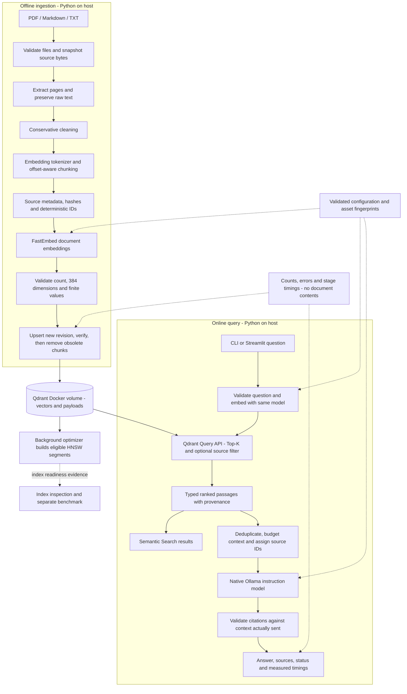
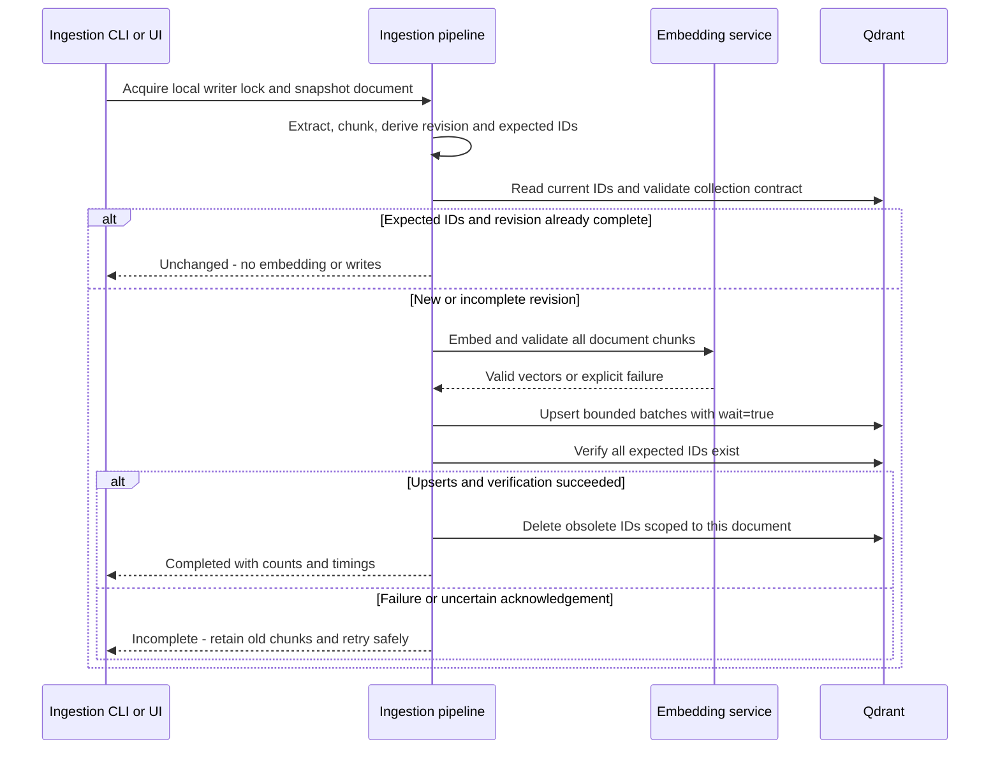

# PLANS.md — RAG Document Search Pipeline

> Phase 0 architecture and implementation roadmap, researched **2026-10-31** and approved by the user in the subsequent review.
> **Phase 1 execution is authorized** by the user's “Begin” response to the Phase 1 scope review. Phases 2 through 7 were authorized by the user on 2026-11-01. Stop after Phase 7 verification; Phases 8–9 require separate approval. GNU AGPL v3 has been selected under the user's delegated license choice. Specification edits remain unauthorized. The user authorized one local commit of Phases 0–6 on 2026-11-01; later commits need a new request, and pushing remains unauthorized.
> “Verified” for Phase 0 means the planning deliverables and documentary checks are complete. It does not mean the proposed software stack has been installed, resolved into a lockfile, or tested together.

## 1. Authority, scope, and progress

Read `AGENTS.md`, `PROJECT_SPEC.md`, and this document in full before each phase. Authority remains: current user instructions → `AGENTS.md` → approved `PLANS.md` → `PROJECT_SPEC.md`.

Two conflicts are resolved explicitly:

- `PROJECT_SPEC.md` §23 says to continue beyond planning. The current request and `AGENTS.md` require stopping after Phase 0; they take precedence.
- The specification labels sixteen implementation sections as phases. The authoritative execution roadmap has **nine implementation phases, 1–9**, plus Phase 0. Section 9 below maps all specification requirements into this roadmap; none are dropped.

Only `PLANS.md` is changed in Phase 0. No dependencies, application modules, model files, services, or CI workflows are created or installed. `AGENTS.md` and `PROJECT_SPEC.md` remain unchanged.

Each later phase follows: restate scope, deliverables, acceptance criteria, and expected files → implement that phase → run relevant checks → document evidence and limitations → report → make a local commit only if authorized → stop. Approval of the roadmap alone does not authorize all phases.

| Phase | Name | Status | Evidence / exit gate |
|---|---|---|---|
| 0 | Architecture validation and planning | Verified | Full document review, official release/API research, compatibility metadata, detailed roadmap, and planning-file checks; architecture and roadmap approved by the user |
| 1 | Project foundation and infrastructure | Verified | Locked Python 3.12.16 install; 44 unit tests; Ruff/format/lock checks; real Qdrant 1.20.0 ARM64 readiness and dashboard; evidence in Section 13 |
| 2 | Document ingestion and chunking | Verified | 167 unit tests; 14 real-tokenizer tests including FastEmbed input-length comparison; dry run of 12 documents with no services; evidence in Section 14 |
| 3 | Embedding generation | Verified | 209 unit tests; 10 real ONNX inference tests; offline load; measured inspection and cosine comparison; evidence in Section 15 |
| 4 | Qdrant storage and HNSW indexing | Verified | 269 unit and 38 integration tests against real Qdrant 1.20.0; restart with identical ID digest; recovery, lock, and 16 mutation checks; evidence in Section 16 |
| 5 | Semantic search | Verified | 8 paraphrases in Top-5 on real Qdrant; filters; Ollama unreachable and never imported; 301 unit and 53 integration tests; ranking weakness recorded; evidence in Section 17 |
| 6 | RAG with Ollama | Verified | Real Qwen generation on Ollama 0.40.13: 15 reviewed questions, exact token counts, live refusal, injection, and failure statuses; 464 tests, 0 skipped; evidence in Sections 18 and 19 |
| 7 | Streamlit application | Verified | 449 unit tests including AppTest; 23 live browser scenarios on real services; real Qdrant and Ollama outages; screenshots from the running app; evidence in Section 20 |
| 8 | Evaluation and benchmarking | Not started | Actual quality reports and reproducible, qualified ANN/exact measurements |
| 9 | Integration, CI/CD, and GitHub documentation | Not started | Clean setup, full workflow evidence, CI, documentation, and publication review |

Statuses are `Not started`, `In progress`, `Blocked`, and `Verified`. Missing infrastructure or model artifacts must be recorded as `Blocked` or `Not run` for the affected check. Mocked tests do not substitute for required real integration acceptance. An optional benchmark can report an honest limitation, but cannot report an unmeasured speedup.

### Repository and environment observed in Phase 0

- Initial Git commit: `24c4f29` (`Initial commit`). The tracked project content is a two-line README; `AGENTS.md`, `PROJECT_SPEC.md`, and `PLANS.md` were already untracked at inspection.
- No `pyproject.toml`, `uv.lock`, application package, tests, Compose file, or workflows exist.
- Shell reports Darwin arm64, macOS 27.2; `python3` is Python 3.9.6. `python3.12`, `uv`, and `ollama` were not found on this shell's PATH. This is not proof they are absent elsewhere.
- Docker CLI 28.4.0 and Compose `v2.39.4-desktop.1` are available. Docker daemon state and service readiness were deliberately not tested.
- RAM inspection through `sysctl -n hw.memsize` was denied by the sandbox. Hardware capacity and performance remain unverified.
- Official package metadata was read over HTTPS; no package distributions or model weights were downloaded. No dependency resolver or application tests were run.

## 2. Technology baseline and compatibility

These were concrete, stable **candidate pins** checked against official releases and package metadata in Phase 0. Phase 1 subsequently resolved and installed the Python dependency graph successfully on macOS ARM64, with native imports verified; see Section 13. `uv.lock` is created but not committed because Git commits are not authorized. Ollama runtime, model behavior, and other platforms remain unverified. Recheck releases at an approved phase boundary; document any version adjustment instead of silently upgrading.

| Component | Recommended baseline | Reason / compatibility evidence |
|---|---|---|
| Python | **3.12.16**, project `>=3.12,<3.13` | Retains the required minor version; latest 3.12 security release found. 3.12 is security-only through October 2028, not the newest Python feature series. [Python release](https://www.python.org/downloads/release/python-31216/) |
| uv / build backend | **uv 0.13.6**, **uv_build 0.13.6** | Native Apple Silicon tooling; managed Python avoids relying on macOS system Python. Use a `src/` package and a pinned build-backend requirement. [uv release](https://pypi.org/project/uv/0.13.6/), [build backend](https://docs.astral.sh/uv/concepts/build-backend/) |
| PDF extraction | **PyMuPDF 2.0** | Python >=3.11; macOS arm64 ABI3 wheel supports 3.12. Use `import pymupdf`; the legacy `fitz` import now warns. [Package](https://pypi.org/project/pymupdf/2.0/), [changes](https://pymupdf.readthedocs.io/en/latest/changes.html) |
| Embeddings | **FastEmbed 0.9.1** | Explicit ONNX inference; Python >=3.10, including 3.12. [Package](https://pypi.org/project/fastembed/0.9.1/), [pinned dependency declarations](https://github.com/qdrant/fastembed/blob/v0.9.1/pyproject.toml) |
| Embedding runtime | **onnxruntime 1.31.1**, CPU package | Satisfies FastEmbed's 3.12 range; CPython 3.12 wheels exist for macOS 14+ arm64 and Linux glibc 2.28+ x86_64/aarch64. Do not install the CUDA package on a Mac. [Metadata and wheels](https://pypi.org/project/onnxruntime/1.31.1/) |
| Embedding model | **BAAI/bge-small-en-v1.5** | Required English model, 384 dimensions, 512-token input ceiling. FastEmbed selects the quantized ONNX export `Qdrant/bge-small-en-v1.5-onnx-Q`. Pin export/tokenizer revisions and hashes when preparing assets. [Model card](https://huggingface.co/BAAI/bge-small-en-v1.5), [FastEmbed model registry](https://github.com/qdrant/fastembed/blob/v0.9.1/fastembed/text/onnx_embedding.py) |
| Tokenization / arrays | **tokenizers 0.23.3**, **numpy 2.5.4** | Directly declare these because project code uses them; both fit FastEmbed/Qdrant/Streamlit constraints. Native wheels cover the target platform. [Tokenizers](https://pypi.org/project/tokenizers/0.23.3/), [NumPy](https://pypi.org/project/numpy/2.5.4/) |
| Asset retrieval | **huggingface-hub 1.33.0** | Latest non-yanked stable 1.x found in PyPI metadata. **Do not select latest 2.4.0:** FastEmbed requires `huggingface-hub<2`. Downloads are explicit preparation commands, never UI/import side effects. [Compatible release](https://pypi.org/project/huggingface-hub/1.33.0/), [FastEmbed constraints](https://github.com/qdrant/fastembed/blob/v0.9.1/pyproject.toml) |
| Vector server / client | **qdrant/qdrant:v1.20.0**, **qdrant-client 1.20.0** | Same release line; supported Query API and typed HNSW/optimizer settings. Record image digest after the Phase 1 pull. [Server release](https://github.com/qdrant/qdrant/releases/tag/v1.20.0), [client](https://pypi.org/project/qdrant-client/1.20.0/) |
| Ollama runtime / client | **Ollama 0.40.13**, **ollama 0.6.3** Python client | Separate version schemes; native host runtime on Apple Silicon, official Python chat client. Pair must be smoke-tested in Phase 6. [Runtime](https://github.com/ollama/ollama/releases/tag/v0.40.13), [Python client](https://pypi.org/project/ollama/0.6.3/) |
| Generation model | **qwen3:4b-instruct-2507-q4_K_M** | Official text instruction model, about 4B parameters, 2.5 GB quantized artifact; explicit non-thinking variant avoids the ambiguous `qwen3:4b` alias. Record local digest after preparation. [Ollama tag](https://ollama.com/library/qwen3:4b-instruct-2507-q4_K_M), [Qwen model card](https://huggingface.co/Qwen/Qwen3-4B-Instruct-2507) |
| UI | **Streamlit 1.66.1** | Python >=3.11; supports resource caching and AppTest. Keep service logic outside the UI. [Package](https://pypi.org/project/streamlit/1.66.1/), [AppTest](https://docs.streamlit.io/develop/api-reference/app-testing/st.testing.v1.apptest) |
| Configuration / models | **pydantic-settings 2.16.2**, **pydantic 2.14.2** | Settings requires Python >=3.11 and Pydantic >=2.7; Ollama requires >=2.9. This pair also satisfies the Qdrant client. [Settings](https://pypi.org/project/pydantic-settings/2.16.2/), [Pydantic](https://pypi.org/project/pydantic/2.14.2/) |
| Tests / quality | **pytest 9.2.0**, **Ruff 0.17.3** | Compatible with Python 3.12; register test markers, set Ruff target `py312`, and use stable rules only. [pytest](https://pypi.org/project/pytest/9.2.0/), [Ruff release](https://github.com/astral-sh/ruff/releases/tag/0.17.3) |
| Containers | **Docker Compose plugin 5.6.1** as current baseline | Use `docker compose` and the Compose Specification. Existing 2.39.4 may handle this simple file but has not been validated with the selected image; record the actual version in Phase 1. [Release](https://github.com/docker/compose/releases/tag/v5.6.1) |
| CI | GitHub-hosted **ubuntu-24.04**; **checkout 7.0.1**, **setup-uv 10.3.3** | Resolve reviewed tags to immutable full commit SHAs in Phase 9. setup-uv can install Python; avoid redundant Python/cache setup. setup-python **7.1.0** is a verified alternative if needed. [checkout](https://github.com/actions/checkout/releases/tag/v7.0.1), [setup-uv](https://github.com/astral-sh/setup-uv/releases/tag/v10.3.3), [setup-python](https://github.com/actions/setup-python/releases/tag/v7.1.0) |

### Compatibility findings and version policy

- Published constraints have a compatible intersection for the selected direct dependencies: NumPy `>=1.26,<3`; Pydantic 2.14.2 satisfies Settings, Ollama, and Qdrant; Tokenizers 0.23.3 satisfies FastEmbed's `>=0.15,<1`. FastEmbed excludes ONNX Runtime 1.20.0, 1.24.0, and 1.24.1 on Python 3.12; 1.31.1 avoids them. The Hub 2.x conflict above is a real reason not to independently choose the newest transitive dependency. [Pinned FastEmbed metadata](https://github.com/qdrant/fastembed/blob/v0.9.1/pyproject.toml), [Streamlit metadata](https://pypi.org/pypi/streamlit/1.66.1/json), [Qdrant metadata](https://pypi.org/pypi/qdrant-client/1.20.0/json)
- Metadata inspection is not a dependency-resolution or binary-import test. Native packages such as ONNX Runtime, Tokenizers, PyMuPDF, NumPy, PyArrow, and Pydantic Core require a compatible wheel or build environment. Primary targets are macOS 14+ Apple Silicon and Ubuntu 24.04 x86_64; Windows and Intel Macs are not verified targets for this baseline.
- `.python-version` will pin 3.12.16. Initial direct dependencies should use the exact candidate versions; `uv.lock` freezes transitive versions and hashes. Pin the build requirement separately as `uv_build==0.13.6`, because build-system resolution is distinct from runtime locking. Install with `uv sync --locked`; verification can use `uv run --locked ...` to prevent implicit lock changes. [uv locking](https://docs.astral.sh/uv/concepts/projects/sync/), [build backend](https://docs.astral.sh/uv/concepts/build-backend/)
- Add dependencies when their public APIs are used; do not rely on accidental transitive imports. `argparse`, `logging`, `hashlib`, `uuid`, `pathlib`, and timing primitives come from the standard library. No additional orchestration framework, API server, ORM, or telemetry platform is needed.
- Model names and package versions do not freeze model contents. An explicit asset-preparation step must record upstream repository/commit, artifact hashes, tokenizer files, ONNX export, and Ollama digest. Actual immutable identifiers will be recorded when assets are prepared; they are not invented in Phase 0.
- Never auto-upgrade models or rebuild an existing collection during application startup. Changes to embedding artifacts or ingestion policy require a deliberate reindex into a new collection.

### API choices and obsolete examples to avoid

| Area | Supported interface / decision |
|---|---|
| Extraction | `pymupdf.open(...)` and page text extraction with explicit ordering options. Do not install the unrelated `fitz` package or adopt a high-level PDF-to-RAG wrapper. |
| Embeddings | Explicit `TextEmbedding(model_name=..., providers=["CPUExecutionProvider"], cache_dir=...)`; service wrappers call `passage_embed(...)` and `query_embed(...)`. Consume generators before validating counts and measuring completed inference. |
| Query/document policy | For this FastEmbed backend, passage/query methods delegate to embedding; do not assume a query instruction is automatically added. Add BGE's recommended retrieval instruction once in the query adapter, include it in token counting, and record the policy. [Base implementation](https://github.com/qdrant/fastembed/blob/v0.9.1/fastembed/text/text_embedding_base.py), [BGE guidance](https://huggingface.co/BAAI/bge-small-en-v1.5) |
| Qdrant storage | `collection_exists`, `create_collection`, `get_collection`, `create_payload_index`, `upsert(wait=True)`, `scroll`, `count(exact=True)`, and scoped `delete(wait=True)`. Validate before writing; do not automatically recreate a collection. |
| Qdrant retrieval | `query_points(collection_name=..., query=<explicit list of floats>, query_filter=..., search_params=SearchParams(...), limit=..., with_payload=True, with_vectors=False).points`. Python uses `search_params`; REST uses `params`. [Query API](https://api.qdrant.tech/api-reference/search/query-points), [pinned Python signature](https://github.com/qdrant/qdrant-client/blob/v1.20.0/qdrant_client/qdrant_client.py) |
| Removed Qdrant APIs | `search`, `search_batch`, and other old methods were removed in client 1.16; `add`/`query` inference shortcuts were deprecated. Do not pass `models.Document` for implicit embeddings. [Removal notes](https://github.com/qdrant/qdrant-client/releases/tag/v1.16.0) |
| HNSW | Collection `HnswConfigDiff(m=16, ef_construct=100, full_scan_threshold=10000)`; query `SearchParams(hnsw_ef=128, exact=False)`. Optimizer `indexing_threshold=20000` is a separate setting. These thresholds are vector **KB**, not point counts; API field names omit the documentation's explanatory `_kb` suffix. [Indexing](https://qdrant.tech/documentation/manage-data/indexing/), [typed configuration](https://github.com/qdrant/qdrant-client/blob/v1.20.0/qdrant_client/http/models/models.py) |
| Exact baseline | `SearchParams(exact=True)`. `exact=False` permits ANN but does not force graph traversal. Do not use `indexed_only=True` to make the benchmark look indexed; it can omit uploaded data. |
| Storage tuning | Keep default in-memory vectors/graph initially. The old `memmap_threshold` optimizer option is deprecated; future disk storage should use supported vector `on_disk` settings after measurement. |
| Ollama | Official `ollama.Client(host=..., timeout=...)` and `client.chat(..., stream=False, options=..., format=<response JSON schema>)`; inspect local model availability/template/capabilities before generation. Handle typed response fields and errors; never auto-pull on failure. [Client](https://github.com/ollama/ollama-python), [chat API](https://docs.ollama.com/api/chat) |
| Settings | `BaseSettings` and `SettingsConfigDict` from `pydantic_settings`, Pydantic v2 validation APIs. Do not use `pydantic.BaseSettings` or v1-only configuration patterns. [Settings documentation](https://docs.pydantic.dev/latest/concepts/pydantic_settings/) |
| Compose | Omit obsolete top-level `version:`; use the plugin command, not legacy Python `docker-compose`. [Compose specification](https://docs.docker.com/reference/compose-file/version-and-name/) |

### Hardware and deployment assumptions

The practical planning target is **16 GiB total RAM** for the complete 4B-model demo with Docker Desktop, Python, and a browser. Search-only work should be comfortable on an 8 GiB machine with a small corpus; a full 4B demo on 8 GiB may encounter memory pressure. These are engineering budgets, not measured minimums or vendor guarantees. Reserve roughly 10 GB of additional free disk for this project's environment, model/cache files, and initial Qdrant data; larger corpora and Docker's own installation require more.

Use one generation request at a time, `num_ctx=4096`, `num_predict=512`, and embedding batches of 32 initially. Lower batch size if memory is constrained. The Qwen artifact is about 2.5 GB on disk; runtime memory also includes caches and inference overhead. Its advertised maximum context is not the intended operating window. [Model artifact](https://ollama.com/library/qwen3:4b-instruct-2507-q4_K_M), [Ollama context sizing](https://docs.ollama.com/context-length)

Run Python and Ollama on the host. Ollama supports Apple M-series CPU/GPU execution and Intel CPU fallback; native macOS use preserves Metal acceleration. FastEmbed starts with ONNX CPU inference, which is a separate execution provider from Ollama's Metal path. [Ollama macOS requirements](https://docs.ollama.com/macos)

Run Qdrant as one Docker service, one shard, one replica, with a named volume mounted at `/qdrant/storage`. Publish only `127.0.0.1:6333:6333`; REST and the dashboard share this port. Leave gRPC 6334 and cluster ports unpublished. Within the container, Qdrant must still listen on its container interface; binding the host publication to loopback is the isolation control. Self-hosted Qdrant has no authentication by default. [Qdrant security](https://qdrant.tech/documentation/security/)

Host URLs are `http://127.0.0.1:6333` and `http://127.0.0.1:11434`. No host-network workaround or `host.docker.internal` is needed while Python stays on the host. Readiness uses the host-accessible `/readyz` endpoint with bounded retries. Do not assume `curl`, `wget`, or a shell exists in the server image for a Compose healthcheck; inspect the image in Phase 1 and otherwise use a host readiness probe. Container running status is not readiness. [Health endpoints](https://qdrant.tech/documentation/ops-monitoring/monitoring/)

## 3. Architecture and boundaries

### End-to-end data flow



HNSW is an internal Qdrant access structure built asynchronously, not a separately deployed service or an operation through which every query necessarily passes. Semantic Search ends at ranked passages and does not construct or contact an Ollama client.

### Document-update sequence and failure boundary



This is an idempotent reconciliation procedure, not a transaction across batches and deletes. During an update, readers can observe old and new revisions together. The local UI should show ingestion in progress; CLI users should query after successful reconciliation. Multi-host writers and atomic snapshots are outside the initial architecture.

### Module contracts

All paths below are **planned**, not present in Phase 0. Package files are under `src/rag_pipeline/`.

| Boundary | Planned files | Inputs → outputs / invariants |
|---|---|---|
| Configuration and shared types | `config.py`, `models.py`, `errors.py`, `logging_config.py` | Validated settings and typed records; validation has no model/service side effects |
| File extraction | `ingestion/document_loader.py` | Allowed local path/bytes → document with raw page text, source identity, byte hash, page metadata |
| Cleaning and tokenization | `ingestion/text_cleaner.py`, `tokenization.py`, `ingestion/chunker.py` | Raw page text → cleaned text and bounded source-preserving chunks |
| Embeddings | `embeddings/embedding_service.py` | Ordered texts or question → validated vectors; no Qdrant or Ollama dependency |
| Storage | `vector_store/qdrant_store.py` | Explicit vectors/payloads → collection operations, query results, statistics |
| Reconciliation | `ingestion/synchronization.py`, `ingestion/ingestion_pipeline.py` | Prepared document revisions → completed/failed per-document ingestion report |
| Retrieval | `retrieval/semantic_search.py` | Question/filter/Top-K → typed ranked passages and timings; no generation dependency |
| Context | `rag/context_builder.py` | Retrieved passages/question → bounded context, included/excluded IDs, citation map |
| Generation | `rag/llm_service.py`, `rag/generation_tokenizer.py` | Validated chat request → Ollama result/diagnostics; no retrieval logic |
| RAG | `rag/citation_validator.py`, `rag/rag_service.py` | Retrieval + context + generation → answer/status/sources with validated references |
| Evaluation | `evaluation/retrieval_metrics.py`, `evaluation/rag_metrics.py` | Labeled judgments and real outputs → reproducible metrics and explicit failure categories |
| Interfaces | `scripts/*.py`, `app/streamlit_app.py` | Thin argparse/Streamlit adapters; no duplicated pipeline logic |

Use small synchronous services with injectable clients/tokenizers for tests. Standard-library logging emits structured events with run/request IDs, stage duration, counts, error category, and safe source identifiers. Avoid document text, questions, model prompts, secrets, and absolute private paths in normal logs.

## 4. Ingestion, embeddings, and data correctness decisions

### Source identity and extraction

- Supported inputs: PDF, UTF-8/UTF-8-BOM Markdown, and TXT. Reject unsupported extensions, unreadable/invalid encodings, corrupt or encrypted PDFs that cannot be opened, and empty documents with actionable per-file outcomes. Do not silently replace undecodable bytes.
- Validate canonical paths against the configured source root. Reject symlinks escaping it. Use a stable configured source namespace plus normalized root-relative path; never base identity on a user's absolute checkout path or basename alone.
- Read a stable snapshot once, hash its bytes with SHA-256, and detect concurrent source changes. Preserve raw extracted text separately from cleaned text in the typed document/page records; do not duplicate entire documents into every vector payload.
- Keep PDF page numbers one-based. Markdown/TXT use null page numbers. Chunk within a page in the initial implementation so the source page is unambiguous. Cross-page sentences/tables and complex multi-column reading order are documented quality limitations.
- Use deterministic extraction settings and record PyMuPDF/extractor versions. Conservative cleaning handles line endings, BOMs, and excess whitespace while preserving paragraphs, headings, numbers, negation, and code. Avoid heuristic deletion of headers/footers or aggressive dehyphenation without fixtures proving correctness.
- Image-only scanned PDFs need OCR, which remains out of scope. Report pages with no extractable text and warn on mixed scanned/text PDFs; do not present a partially extracted document as fully covered.

### Token-aware chunking and no hidden truncation

Use the tokenizer artifacts associated with the exact FastEmbed ONNX export. A small `tokenizers` adapter can load tokenizer-only assets in Phase 2 without loading ONNX weights. Counting must disable tokenizer truncation and padding on a separate tokenizer instance. FastEmbed's own preprocessing enables truncation, so counting an already truncated encoding cannot protect the source. [FastEmbed preprocessing](https://github.com/qdrant/fastembed/blob/v0.9.1/fastembed/common/preprocessor_utils.py)

Start with 256 content tokens and 40 tokens of overlap. Validate `0 <= overlap < chunk_size` and the complete encoder input, including special tokens and any instruction prefix, against the 512-token limit. Documents receive no query instruction; questions receive the BGE retrieval instruction exactly once. Reject oversized questions with a shortening message.

Split by tokenizer character offsets into the cleaned source text; do not reconstruct displayed text by decoding normalized WordPiece tokens. Prefer paragraph/sentence boundaries within the budget, then use bounded token windows when needed. Retokenize each final substring before accepting it. Every non-whitespace region of cleaned text must be covered, progress must be strictly positive, and no empty or oversized chunk may pass. Unicode, long uninterrupted text, special-token-looking strings, and boundary retokenization require tests.

Store raw-text provenance through the source snapshot/hash and page metadata, plus offsets in **cleaned** page text. Do not label cleaned offsets as raw PDF coordinates. Chunking changes require a new processing fingerprint and deliberate reindexing.

### Embedding invariants and reproducibility

- Initialize the selected FastEmbed model explicitly and reuse one instance. Default CPU provider, batch size 32, bounded threads; tune only after measuring.
- For every batch require exactly one vector per input, exactly 384 values per vector, finite numeric values, a nonzero norm, and preserved order. Materialize/validate generators within the measured operation. Reject any partial/malformed batch before storage.
- Convert vectors to a Qdrant-compatible float representation without placing copies in payloads. Cosine scores express ranking similarity, not probability or answer confidence.
- Fingerprint logical model name, ONNX artifact hash/revision, tokenizer hash/revision, query/document instruction policy, and preprocessing/chunking schema. Record library versions in run metadata.
- Explicit asset preparation writes downloads only to an ignored cache and records immutable metadata in a small manifest. Normal ingestion/search use prepared local assets and fail clearly if missing; imports, tests, and UI startup must not trigger downloads.
- A new model with the same 384 dimensions is still a different vector space. Validate model/processing fingerprints as well as dimensions; never mix incompatible vectors in an existing collection.
- English is the validated language scope. A multilingual generation model does not make an English embedding model multilingual.

### IDs, payloads, and synchronization

Use an application UUID namespace constant and UUIDv5 for deterministic identifiers:

- `document_id`: source namespace + normalized relative path.
- `document_hash`: SHA-256 of source bytes.
- `revision_id`: document hash + processing fingerprint.
- `chunk_id`/Qdrant point ID: document ID + revision ID + page + chunk ordinal + chunk text hash.

A content update keeps the document ID and creates a new set of deterministic chunk IDs. Initially, all chunks of an edited document are re-embedded; unchanged documents are skipped. This trades some update work for a simpler recovery model. A path rename is a new document plus a separately reconciled removal. Identical bytes at distinct source paths remain distinct provenance records.

Payloads include the specification's `chunk_id`, `document_id`, `source`, `page_number`, `chunk_index`, `text`, `content_hash`, and `embedding_model`. Define `content_hash` as the chunk text hash; also store `document_hash`, `revision_id`, source namespace, cleaned offsets, processing fingerprint, asset identity, schema version, and ingestion metadata. Validate payloads on both write and read.

Use paginated Qdrant scroll/count operations to reconcile expected IDs; no new relational database is needed. Validate size/cosine via collection configuration and validate existing payload fingerprints before adding documents. Unknown or incompatible existing contents must produce a migration error, not deletion.

One writer per collection is enforced with a local process/file lock shared by CLI and UI. Current targets are macOS/Linux; do not claim this coordinates writers on different machines. For each document:

1. Extract and derive the complete expected chunk set before embedding or mutating Qdrant.
2. Skip embedding/writes only when the expected revision and complete ID set already exist. Counts alone cannot establish completeness.
3. Validate embeddings, upsert batches with bounded retries and `wait=True`, then verify expected IDs.
4. Only after verification, delete obsolete IDs belonging to the same source namespace and document.
5. On any failure, report incomplete status; retain old chunks. A subsequent run re-upserts deterministic IDs and finishes cleanup, including obsolete partial revisions.

Invalid/empty updated files retain the previous indexed revision and visibly report that it is stale. A disappeared file is not silently deleted. Provide explicit document deletion and opt-in `--prune-missing` with `--dry-run`. Pruning requires a successful complete inventory of a declared authoritative source root; an unavailable root, access error, or partial walk disables pruning. A manifest loss or a failed operation is never permission to clear the collection.

## 5. Retrieval, HNSW, and benchmark design

Create one dense, unnamed vector field with cosine distance and size derived from the embedding service, asserted to be 384 for the selected model. Create keyword indexes for fields used in synchronization and filtering, including source namespace, document ID, source, revision, and processing fingerprint, before loading data. Do not add a full-text index merely because text is in the payload.

Semantic search validates a nonempty bounded question, Top-K (initial default 5, UI cap 20), and an optional exact source/document filter. It embeds once and calls the Query API with explicit numeric vectors. Preserve Qdrant scores and provenance, using deterministic secondary ordering for ties without inventing scores. Return embedding, vector-query, and total retrieval timings separately. Missing Qdrant or assets yields actionable errors; missing Ollama has no effect.

Do not set an arbitrary cosine cutoff as a universal answerability test. Start with no threshold; document and evaluate any later threshold against labeled answerable and unanswerable cases.

### What index inspection can and cannot establish

The normal collection starts with `m=16`, `ef_construct=100`, query `hnsw_ef=128`, `full_scan_threshold=10000`, and `indexing_threshold=20000`. These are starting values, not performance recommendations demonstrated by measurements. The optimizer threshold controls when a segment becomes indexable; the full-scan threshold influences query planning. Setting optimizer `indexing_threshold=0` disables indexing rather than forcing it.

A float32 384-dimensional vector occupies 1,536 raw bytes, about 1.5 KiB. Thus 10,000 vectors are about 15,000 KiB before graph/payload overhead, and segment splitting matters. A 10,000-vector benchmark with untouched thresholds may never construct HNSW.

`inspect_index.py` must show collection and optimizer status, exact point count separately from approximate collection counters, indexed-vector count when available, segment count, vector size/distance, payload schema, and resolved HNSW/optimizer parameters. Green collection status alone is insufficient. Tiny sample-policy collections may appropriately use full scans.

No public query response field is assumed to prove HNSW traversal. Configuration plus indexed-vector counts establish eligibility/readiness, not the path of every query. If exact traversal cannot be observed, label the comparison “exact search versus ANN-permitted search on an indexed collection.”

### Isolated benchmark protocol

- Separate collection named `rag_benchmark_<run_id>`, guarded against using the application collection. Create a fresh collection; cleanup only a collection created by that run.
- Synthetic, normalized float32 vectors of dimension 384; deterministic seed 42; configurable N, initially 10,000 and optionally 50,000. Generate independent held-out query vectors, not copies of inserted points. These data test ANN mechanics, not language retrieval quality.
- Use one shard and target one optimizer segment. Bulk load with indexing temporarily disabled, then enable `indexing_threshold=1024` KB and `full_scan_threshold=1` KB. Keep quantization off. Record the actual resolved configuration.
- Poll with a timeout for optimizer completion, no optimizer error, exact count N, and a stable substantial indexed-vector count (target at least 95% of N). Report the indexed fraction and remaining plain segments. A failed gate gives a diagnostic/blocked result, not a graph speedup claim.
- Measure upload duration separately. Time from enabling indexing until the readiness gate as **index readiness wall time**, not isolated HNSW construction CPU time.
- Use the identical 100 held-out queries, Top-K=10, 20 warmup queries per mode, three timed repetitions, serial requests, fixed payload/vector-return settings, and balanced/interleaved mode order. Compare `exact=True` with `exact=False` and `hnsw_ef` 32/64/128/256.
- Exact returned IDs are the ground truth. Compute per-query intersection@K divided by K, then average; define handling of ties and ensure N >= K. Record mean/p50/p95 client latency, server time where available, recall, seed, dataset size, index counters, versions, hardware, and concurrency.
- Record measured memory only if an actual measurement is available; distinguish Docker VM/container figures from total process/host memory. Raw vector bytes are an analytical estimate, not resident memory.
- Save reports to ignored `artifacts/benchmarks/`; publish only reviewed synthetic/fictional summaries. Make no target speedup promise. High-dimensional random data and a laptop Docker VM do not predict production workloads.

## 6. Context construction, generation, and trust boundaries

Use the retrieval service unchanged as RAG's input. `ContextBuilder` deduplicates repeated text while retaining all provenance, selects ranked passages, assigns request-local source IDs such as `[S1]`, and produces a map containing only passages **actually sent** to the model.

Embedding tokens and LLM tokens are different. The 512-token BGE tokenizer must not be used to enforce a Qwen context budget. A lightweight `tokenizers` adapter loads the selected Qwen tokenizer; a tested chat-template adapter matches the template of the actual Ollama artifact. Inspect the local model/template and compare token counts with Ollama's reported prompt counts in controlled Phase 6 checks. Unknown or changed model/template combinations fail clearly until their budgeting adapter is verified.

Proposed defaults:

| Setting | Default / constraint |
|---|---|
| `OLLAMA_MODEL` | `qwen3:4b-instruct-2507-q4_K_M` |
| `OLLAMA_NUM_CTX` | 4096, capped by the actual model's supported context |
| `RAG_MAX_CONTEXT_TOKENS` | 3000 **LLM** tokens, an upper bound rather than a reserved allocation |
| `RAG_MAX_OUTPUT_TOKENS` | 512, passed as `num_predict` |
| `RAG_CONTEXT_SAFETY_TOKENS` | 128 in addition to counted template overhead |
| `RAG_TEMPERATURE` | 0; improves repeatability but does not guarantee deterministic or correct answers |
| `OLLAMA_TIMEOUT_SECONDS` | 120 initially, with one generation request at a time |
| `OLLAMA_NO_CLOUD` | 1 in the Ollama **server** environment, not merely the Python app's dotenv |

The available passage budget is the smaller of 3000 and the configured context window minus the counted system/question/template tokens, reserved output tokens, and safety margin. Count the complete assembled prompt again. Remove lowest-ranked whole passages if necessary; report omitted IDs and reasons. Reject a question or fixed prompt that cannot fit. Do not silently rely on server truncation or character-count heuristics. A generation ending at the output limit must be marked incomplete rather than presented as a finished answer.

The selected Qwen model is a non-thinking instruction variant, so no reasoning channel or tool loop is needed. Use system and user messages with clearly delimited source data. The system instruction asks for evidence-based answers, source IDs, refusal when support is insufficient, and disregard for instructions inside documents. The adapter exposes no tools, shell execution, URL retrieval, or cloud fallback. [Qwen behavior](https://huggingface.co/Qwen/Qwen3-4B-Instruct-2507), [Ollama local-only mode](https://docs.ollama.com/faq)

Request a minimal JSON response with an answer string and an insufficient-evidence boolean using Ollama's schema format; validate it with Pydantic before interpreting the result. This makes refusal status explicit without an unreliable phrase-matching classifier. Schema-constrained output does not establish truthful content.

Citation validation parses references in the answer, checks syntax and membership in the included-source map, detects unknown IDs, and requires citations for a substantive answer. Refusal is an explicit response status. Do not repair invented source IDs by guessing. Invalid or missing citations cannot be labeled validated/grounded; return an explicit validation failure with diagnostics. Citation validity does not establish entailment, factual correctness, or immunity to prompt injection.

Empty retrieval or empty usable context returns an insufficient-evidence result without calling Ollama. With nonempty but irrelevant passages, the model is instructed to refuse; this behavior must be evaluated, not assumed. Scores alone cannot prove that no answer exists.

The RAG result includes question, answer/status, included and retrieved sources, citation validation, similarity scores, context omissions, retrieval/context/generation/total timing, model identity, and completion diagnostics. Missing service/model, connection timeout, malformed response, prompt overflow, and invalid citations remain distinct errors. Search remains usable through every generation failure.

### Input and local security controls

- The initial deployment is a trusted single-user localhost application, not a public multi-user service. Bind Streamlit to `127.0.0.1`; keep browser security defaults enabled.
- Uploads are local files only, allowlisted by type, validated by parser, with configurable limits (initial 20 MiB/file, 500 PDF pages, and 2 million extracted characters). Exceeding a limit rejects the file; it does not silently index a prefix.
- Store uploads under an ignored application-owned directory with generated storage names and explicit source identity; never trust a supplied path or allow overwriting repository files. Do not fetch external links or execute embedded content.
- Render passages as text/safe Markdown without enabling raw HTML. Application-created citation links resolve from trusted metadata rather than model-generated filenames or URLs.
- Local parsing of malformed PDFs is still a native-library risk; keep the parser patched and bound resource use. Adversarial multi-tenant document processing would require stronger isolation and a separately approved architecture.
- Exclude `.env`, caches, model assets, private documents, upload directories, Docker volumes, and sensitive reports from Git. Use fictional samples and inspect screenshots before publication. Disable optional Streamlit usage collection; document Qdrant/Ollama telemetry settings.
- Public license decision: retain PyMuPDF and use **GNU AGPL v3 (`AGPL-3.0-only`)** for the portfolio repository. The user delegated this choice after the recommendation and source-sharing implications were explained. Add the license during authorized Phase 1 work. PyMuPDF is offered under AGPL or a commercial license. [Publisher licensing](https://pymupdf.readthedocs.io/en/latest/about.html)

## 7. Verification strategy and phase gates

“Independently verifiable” means a phase depends only on its declared earlier prerequisites, not on unfinished later phases. Extraction needs no vector store; embeddings need no Qdrant; storage tests can use synthetic vectors; search needs no LLM; RAG tests can inject retrieval; evaluation needs no UI.

Every implementation phase adds its own tests and documentation. Phase 9 consolidates them; it is not the first testing phase.

### Shared quality gate

After Phase 1 configures the project, run these from the repository root for every phase:

```bash
uv lock --check
uv run --locked ruff check .
uv run --locked ruff format --check .
uv run --locked pytest
```

Configure plain `uv run pytest` to collect the deterministic unit suite (including later mocked UI tests) via `testpaths = ["tests/unit"]`. Register `integration`, `model`, `ollama`, and `benchmark` markers with strict marker validation. Integration tests are invoked with explicit paths; they must never download assets or start services implicitly. If an explicitly requested integration prerequisite is absent, report the failure/blocked check clearly; skipped tests are not passing evidence. [pytest marker behavior](https://docs.pytest.org/en/stable/how-to/mark.html)

Required real checks use the pinned Qdrant Docker server, not the Python client's in-memory/local implementation as evidence for HNSW, persistence, or optimizer behavior. All destructive integration tests use unique disposable test collections and temporary fictional files, never the configured application collection.

**The commands below are proposed acceptance interfaces to implement in the named phase. They do not exist or pass merely because they are listed. None were executed in Phase 0.** Record exact results and any changed command contracts when implementing.

## 8. Detailed implementation roadmap

### Phase 0 — Architecture Validation & Project Planning

**Objective:** Validate the proposed architecture and turn the specification into a reviewable, gated implementation plan.

**Dependencies:** Existing project documents, read-only repository/environment inspection, and official documentation/release metadata.

**Scope and deliverables:** Read all three control documents; reconcile numbering and scope conflicts; verify current APIs and candidate version constraints; identify resource, licensing, reliability, and security concerns; specify contracts, diagrams, phase files, checks, and approval decisions.

**Files:** Only `PLANS.md`.

**Acceptance criteria:** Complete requirement coverage; directly linked primary sources; explicit distinction between documentary compatibility and runtime verification; concrete version baseline; independent phase checks; risks and proposed spec edits; no application/dependency/model/service changes; a clear stop for user approval.

**Verification:** Repository/status inspection, official package/release/API research, planning structure and fence checks, whitespace review, and before/after hashes for protected files. Exact observed commands/results are recorded in Section 12.

**Exit:** Planning work verified; architecture and roadmap approved. Phase 1 execution and all implementation checks remain pending.

### Phase 1 — Project Foundation & Infrastructure

**Objective:** Establish a reproducible Python package and local Qdrant deployment.

**Dependencies:** Explicit Phase 1 approval; install/configure uv and Python 3.12 if missing; Docker daemon availability for infrastructure checks. Repository license selection is resolved: GNU AGPL v3 (`AGPL-3.0-only`).

**Scope:** Resolve and lock the complete selected dependency set to expose compatibility issues early, without loading models. Create package/configuration/logging/error foundations, Ruff/pytest configuration, ignored local directories, a loopback-only Compose service with persistent volume, and tested readiness instructions. Configuration validates values and cross-field limits without contacting services.

**Required files:** `pyproject.toml`, `uv.lock`, `.python-version`, `.env.example`, `.gitignore`, `docker-compose.yml`; `src/rag_pipeline/__init__.py`, `config.py`, `errors.py`, `logging_config.py`; `tests/conftest.py`, `tests/unit/test_config.py`, `test_foundation.py`; initial README setup and `docs/engineering_decisions.md`; `LICENSE` (license choice approved); progress in `PLANS.md`.

**Deliverables:** Locked install, typed settings with all proposed defaults, safe logs, test scaffolding, and accessible Qdrant readiness/dashboard. No ingestion or inference functionality.

**Acceptance criteria and tests:**

- Package imports under Python 3.12; installing/importing dependencies makes no model download or service call.
- Settings cover Qdrant URL/collection/timeouts/HNSW, model/cache identities, chunk and batch limits, Top-K, Ollama generation/context limits, source roots, upload limits, and log level. Tests cover invalid values, cross-field failures, environment precedence, and safe secret representation.
- `uv.lock` is current; compatible native imports succeed; exact versions/platform are recorded.
- Compose config has one pinned Qdrant image, a named volume, and only loopback host publication. The selected image has an available native arm64 variant on this host.
- Real `/readyz` succeeds and `/` reports the expected server version; dashboard is reachable. If Docker is unavailable, keep the infrastructure exit gate blocked.
- Shared quality gate passes.

**Verification commands:**

```bash
uv --version
uv python install 3.12.16
uv lock
uv sync --locked
uv run --locked python --version
uv run --locked pytest tests/unit/test_config.py tests/unit/test_foundation.py
docker compose version
docker compose config --quiet
docker compose up -d qdrant
curl -fsS --retry 10 --retry-connrefused --retry-delay 2 http://127.0.0.1:6333/readyz
curl -fsS http://127.0.0.1:6333/
docker compose images
docker image inspect qdrant/qdrant:v1.20.0 --format '{{json .RepoDigests}}'
```

Record the pulled image digest, inspect `http://127.0.0.1:6333/dashboard`, then run the shared quality gate. Do not download tokenizer/embedding/LLM assets in this phase.

### Phase 2 — Document Ingestion & Chunking

**Objective:** Convert supported documents into deterministic, source-preserving, token-bounded chunks without inference or a database.

**Dependencies:** Phase 1; explicit preparation of small embedding tokenizer artifacts only. No ONNX weights, Qdrant, or Ollama required.

**Scope:** Typed document/page/chunk records, safe loaders, conservative cleaning, hash/ID functions, model-compatible tokenizer adapter, offset-aware chunker, and dry-run ingestion reporting. Create all **12 fictional policy documents** requested in the specification, covering leave, remote work, equipment, security, travel, expenses, onboarding, training, incidents, conduct, and sick leave.

**Required files:** `models.py`, `tokenization.py`; `ingestion/__init__.py`, `document_loader.py`, `text_cleaner.py`, `chunker.py`, preparation portion of `ingestion_pipeline.py`; `scripts/prepare_assets.py`, `scripts/ingest.py` (dry-run only); metadata-only `model_assets.json`; `data/sample_docs/*`; small fictional PDF/encoding fixtures; `tests/unit/test_document_loader.py`, `test_text_cleaner.py`, `test_chunker.py`, `test_identifiers.py`; `tests/integration/test_embedding_tokenizer.py`; ingestion/chunking documentation and `PLANS.md`.

**Deliverables:** Deterministic extraction/chunks, explicit tokenizer preparation, complete sample corpus, dry-run counts and per-document failures.

**Acceptance criteria and tests:**

- PDF/Markdown/TXT success cases preserve source path, ID, filename, raw extracted text, byte hash, page metadata, and useful modification metadata.
- Tests cover corrupt/encrypted/scanned/partly scanned PDFs, empty pages/files, unsupported types, invalid UTF-8, duplicate filenames in distinct roots, and unsafe paths.
- Repeated runs yield identical hashes and IDs; byte/content, path, page, and processing-policy changes behave as documented.
- Tests prove overlap, progress, source coverage, final-substring token bounds, preserved original capitalization/display text, and invalid configuration rejection, including Unicode and special-token-looking inputs.
- Real tokenizer verification tests the complete BGE encoder input ceiling and the 256/40 defaults; toy tokenizer tests alone cannot establish model compatibility.
- Dry-run reports no vector writes and requires no running services. Real tokenizer artifacts are ignored; only their identity/checksum manifest is tracked.

**Verification commands:**

```bash
uv run --locked python scripts/prepare_assets.py --embedding-tokenizer
uv run --locked pytest tests/unit/test_document_loader.py tests/unit/test_text_cleaner.py tests/unit/test_chunker.py tests/unit/test_identifiers.py
uv run --locked pytest tests/integration/test_embedding_tokenizer.py
uv run --locked python scripts/ingest.py --dry-run
```

Run the shared quality gate. Missing tokenizer connectivity/assets blocks the real tokenizer acceptance check; it does not justify silently switching to a whitespace tokenizer.

### Phase 3 — Embedding Generation

**Objective:** Make the transformation from chunk text and questions into validated dense vectors explicit and inspectable.

**Dependencies:** Phases 1–2; explicit model artifact preparation and enough local CPU/RAM. No Qdrant or Ollama required.

**Scope:** Reusable FastEmbed service, passage/query paths with recorded instruction policy, batching, strict output validation, local-cache-only normal operation, timings, and a cosine-similarity demonstration.

**Required files:** `embeddings/__init__.py`, `embeddings/embedding_service.py`; extend asset preparation/manifest and shared types; `scripts/inspect_embeddings.py`; `tests/unit/test_embedding_service.py`, `tests/integration/test_embeddings.py`; `docs/embeddings.md`, setup notes, and `PLANS.md`.

**Deliverables:** Explicit embedding API, prepared immutable asset identities, inspect CLI with model/dimensions/first 10 values/time/validation, and measured sentence-comparison output.

**Acceptance criteria and tests:**

- Unit tests inject a fake backend and cover empty input policy, order, batch cardinality, 383/385-dimensional outputs, NaN/Inf, zero vectors, generator failure, oversized input, and duplicate query prefixes.
- One model instance is reused; initialization/download cost is distinguished from warm inference time.
- Real tests return finite nonzero 384-dimensional vectors for passages and questions and verify tokenizer/export correspondence.
- The optional laptop/computer/pizza comparison reports actual cosine values; no hardcoded score or guaranteed numeric margin.
- Missing or mismatched artifacts fail with a preparation instruction, without automatic network access.

**Verification commands:**

```bash
uv run --locked python scripts/prepare_assets.py --embedding-model
uv run --locked pytest tests/unit/test_embedding_service.py
uv run --locked pytest tests/integration/test_embeddings.py
uv run --locked python scripts/inspect_embeddings.py "Employees receive 25 days of annual leave."
uv run --locked python scripts/inspect_embeddings.py --compare
```

Run the shared quality gate. If real inference is unavailable, report the phase's real-model gate blocked even when mocked tests pass.

### Phase 4 — Qdrant Vector Storage & HNSW Indexing

**Objective:** Persist explicit vectors and provenance, reconcile document revisions safely, and expose truthful index status.

**Dependencies:** Phases 1–3 for full ingestion; Qdrant server from Phase 1. The storage adapter's own real-server tests use deterministic synthetic vectors and need no embedding model.

**Scope:** Collection contract creation/validation, keyword payload indexes, bounded upserts, supported Query API adapter, scrolling/counting/deletion, single-writer reconciliation, explicit missing-file pruning, retry/recovery behavior, and index inspection. Extend the existing dry-run ingestion CLI to real ingestion. HNSW benchmark implementation stays in Phase 8.

**Required files:** `vector_store/__init__.py`, `vector_store/qdrant_store.py`; `ingestion/synchronization.py`, completed `ingestion_pipeline.py`; extend `scripts/ingest.py`; `scripts/inspect_index.py`; `tests/unit/test_qdrant_store.py`, `test_synchronization.py`; `tests/integration/test_qdrant_store.py`, `test_ingestion_sync.py`; `docs/vector_indexing.md`, reliability notes, and `PLANS.md`.

**Deliverables:** Repeatable end-to-end ingestion, explicit update/deletion interfaces, recovery reporting, persistent vectors, and accurate collection/index diagnostics.

**Acceptance criteria and tests:**

- Collection size/cosine/schema/fingerprints are validated; an incompatible populated collection is rejected without mutation. Vectors are stored as vectors, not payload copies.
- Reingesting unchanged documents preserves IDs/counts and avoids new embeddings. Changing and shortening a document replaces text and removes obsolete chunks while another document stays intact.
- Tests cover multiple batches, partial upsert, uncertain acknowledgement, failed verification, failed deletion, retry after interruption, missing-file dry-run/pruning, incomplete inventory, and writer-lock contention.
- An invalid updated source retains the previous revision with a stale/error report. No delete happens before new-revision verification.
- Real integration tests verify payload filters, paginated reconciliation, exact expected IDs, finite vector round trips, and persistence across a Qdrant restart.
- Inspection reports resolved HNSW/optimizer settings and indexed count, including zero-indexed small collections without claiming HNSW use.
- Completed ingestion logs document/chunk/vector/delete/failure counts and real stage durations.

**Verification commands:**

```bash
uv run --locked pytest tests/unit/test_qdrant_store.py tests/unit/test_synchronization.py
uv run --locked pytest tests/integration/test_qdrant_store.py
uv run --locked python scripts/ingest.py
uv run --locked python scripts/ingest.py
uv run --locked pytest tests/integration/test_ingestion_sync.py
uv run --locked python scripts/ingest.py --prune-missing --dry-run
uv run --locked python scripts/inspect_index.py
docker compose restart qdrant
curl -fsS --retry 10 --retry-connrefused --retry-delay 2 http://127.0.0.1:6333/readyz
uv run --locked python scripts/inspect_index.py
```

Compare exact expected point IDs/counts before and after restart, not just container status. Run the shared quality gate. Never use volume deletion as a test reset.

### Phase 5 — Semantic Search

**Objective:** Retrieve understandable ranked passages through the supported Query API without any generation dependency.

**Dependencies:** Phases 1–4, prepared embedding assets, and an ingested sample collection. Ollama is not a prerequisite.

**Scope:** Question/Top-K/filter validation; one query embedding; Query API retrieval; typed scores and provenance; latency reporting; and thin search CLI.

**Required files:** `retrieval/__init__.py`, `retrieval/semantic_search.py`; search response types; `scripts/search.py`; `tests/unit/test_semantic_search.py`, `tests/integration/test_semantic_search.py`; README search examples and `PLANS.md`.

**Deliverables:** Semantic Search service and working question/source-filter commands.

**Acceptance criteria and tests:**

- Tests verify explicit vector arguments, filter translation, Top-K boundaries, query prefix/token limits, empty results, invalid payloads, score ordering/ties, timeouts, and unavailable Qdrant.
- At least five curated paraphrased policy questions retrieve their expected policy among Top-5, with correct filename/page/chunk metadata. Record actual rankings/scores.
- A source filter never leaks passages from another source. Returned scores are not presented as calibrated confidence.
- Both imports and successful real search work with an unreachable Ollama URL; no generation client is instantiated.

**Verification commands:**

```bash
uv run --locked pytest tests/unit/test_semantic_search.py
uv run --locked pytest tests/integration/test_semantic_search.py
uv run --locked python scripts/search.py "Can I work remotely?"
uv run --locked python scripts/search.py "How much vacation time do I get?" --top-k 5 --source annual_leave_policy.md
OLLAMA_BASE_URL=http://127.0.0.1:1 uv run --locked python scripts/search.py "My laptop stopped charging."
```

Run the shared quality gate. Full quality evaluation remains in Phase 8; these are concrete retrieval smoke cases.

### Phase 6 — RAG with Ollama

**Objective:** Reuse retrieval to produce bounded, evidence-based answers with validated source references and explicit failure states.

**Dependencies:** Phases 1–5 for the full pipeline; native Ollama and the selected local model; prepared Qwen tokenizer/template adapter. Context, citation, and orchestration unit tests need neither live service.

**Scope:** Context selection and LLM token budgeting; model/template verification; official Ollama chat adapter; grounded prompting; citation validation; RAG orchestration; and answer CLI. No agents, tools, long-term memory, fine-tuning, cloud inference, or streaming UI requirements.

**Required files:** `rag/__init__.py`, `context_builder.py`, `generation_tokenizer.py`, `llm_service.py`, `citation_validator.py`, `rag_service.py`; shared response types; extend asset manifest/preparation; `scripts/ask.py`; `tests/unit/test_context_builder.py`, `test_citation_validator.py`, `test_llm_service.py`, `test_rag_service.py`; `tests/integration/test_generation_tokenizer.py`, `test_rag_ollama.py`; `docs/rag_explained.md`, setup/troubleshooting notes, and `PLANS.md`.

**Deliverables:** Answer CLI, verified model identity/context behavior, citation map and validation result, explicit insufficient-evidence/outage responses, and measured timings.

**Acceptance criteria and tests:**

- Test full assembled prompts, question/template/output reserves, overlap deduplication, omitted passages, Unicode, boundary sizes, unknown tokenizer/template identities, and output-limit termination.
- The generation tokenizer/template must not underestimate observed prompt use in controlled real-model checks; discrepancies require adapter correction or a conservative proven bound before acceptance.
- Test citations to included passages, unknown IDs, retrieved-but-excluded IDs, malformed/no citations, refusals, and malicious instructions embedded in source text.
- Empty retrieval/context skips generation. Missing model, unavailable server, timeout, malformed response, and invalid citations have distinct statuses.
- Real smoke cases cover annual leave, a question using multiple supporting passages, and an unanswerable question. Check support and refusal manually using the Phase 6 rubric; citation membership alone is insufficient.
- Repeat semantic search while Ollama is unreachable. No hidden download or cloud fallback is allowed.
- Logs and responses separate retrieval, context, generation, and total time; temperature 0 is not described as a correctness guarantee.

**Verification commands:**

First start the native server with cloud features disabled, in a separate terminal (or use the documented macOS app environment configuration):

```bash
OLLAMA_NO_CLOUD=1 ollama serve
```

Then, only within this approved phase:

```bash
ollama --version
ollama pull qwen3:4b-instruct-2507-q4_K_M
ollama show qwen3:4b-instruct-2507-q4_K_M
uv run --locked python scripts/prepare_assets.py --generation-tokenizer
uv run --locked pytest tests/unit/test_context_builder.py tests/unit/test_citation_validator.py tests/unit/test_llm_service.py tests/unit/test_rag_service.py
uv run --locked pytest tests/integration/test_generation_tokenizer.py tests/integration/test_rag_ollama.py
uv run --locked python scripts/ask.py "How many days of annual leave do employees get?"
uv run --locked python scripts/ask.py "What is the policy on underwater vacations?"
ollama ps
```

Record the model digest, allocated context, offloading mode, and actual outcomes. Run the shared quality gate. Missing model/service or an unverified budgeting adapter blocks the real RAG gate.

### Phase 7 — Streamlit Application

**Objective:** Expose the verified services in a clear local application.

**Dependencies:** Phases 1–6. Mocked UI tests need no services; live RAG validation needs both services, while live search needs only Qdrant and embeddings.

**Scope:** Three sections: Semantic Search, RAG Assistant, and Pipeline Inspection. Include question/Top-K/source controls, snippets/scores/provenance, answer/citation status, timings, document/chunk counts, vector/model/collection/index details, sample-ingestion action, and bounded local document uploads. UI actions delegate to existing services.

**Required files:** `app/streamlit_app.py`, `.streamlit/config.toml`; only small necessary service-factory/config additions; `tests/unit/test_streamlit_app.py`; real screenshots under `docs/images/` when available; UI instructions and `PLANS.md`.

**Deliverables:** Functional local app, mock UI tests, live inspection evidence, and actual screenshots.

**Acceptance criteria and tests:**

- AppTest verifies all sections, forms/buttons, validation, successful mock results, errors, empty collection, and source rendering. Test upload/path/type/size rejection through the existing ingestion boundary.
- Cache model/client resources using stable configuration/asset fingerprints. Shared cached resources must be thread-safe or serialized; avoid caching sensitive question/results globally. Ingestion must invalidate any cached counts/results that can become stale. [Streamlit resource caching](https://docs.streamlit.io/develop/api-reference/caching-and-state/st.cache_resource)
- Manual/live checks cover sample ingestion, upload, source filters, answer citations, inspection, Qdrant outage, missing model, and Ollama outage. Report success only after operations finish.
- Search still works when RAG is unavailable. Generated answers and retrieved evidence remain visually distinct.
- Source passages are safely rendered; upload storage cannot overwrite repository paths. UI binds only to localhost.
- Screenshots show the actual application and fictional data.

**Verification commands:**

```bash
uv run --locked pytest tests/unit/test_streamlit_app.py
uv run --locked streamlit run app/streamlit_app.py --server.address 127.0.0.1
```

Run the live scenario checklist above, record outcomes/screenshots, and run the shared quality gate. A server that merely starts is not UI acceptance.

### Phase 8 — Evaluation & Benchmarking

**Objective:** Measure retrieval/RAG quality and ANN tradeoffs honestly and reproducibly.

**Dependencies:** Phases 1–5 for retrieval evaluation; Phase 6 for RAG evaluation; Phase 4 for the isolated vector benchmark. UI is not required.

**Scope:** A labeled fictional evaluation set; deterministic metric functions; reviewable human correctness/refusal rubric; real evaluation CLI; and the isolated benchmark protocol from Section 5. No paid or uncalibrated LLM judge is required.

**Required files:** `evaluation/__init__.py`, `retrieval_metrics.py`, `rag_metrics.py`; `scripts/evaluate.py`, `scripts/benchmark.py`; `data/evaluation/questions.jsonl`, label/rubric documentation; `tests/unit/test_retrieval_metrics.py`, `test_rag_metrics.py`, `test_benchmark_protocol.py`; `tests/integration/test_evaluation.py`, `test_benchmark_qdrant.py`; `docs/evaluation.md`, extend `docs/vector_indexing.md`, and `PLANS.md`. Reports go to ignored `artifacts/evaluation/` and `artifacts/benchmarks/`.

**Deliverables:** At least 25 labeled questions (10 straightforward, 5 paraphrased, 5 multi-passage, 5 unanswerable), real reports, a completed correctness/refusal review for the RAG run, and qualified ANN/exact measurements or an explicit benchmark limitation.

**Acceptance criteria and tests:**

- Answerable cases have reference answers, stable source/document IDs, supporting passage labels, and corpus/processing fingerprints. Validate label references before running; stale labels fail clearly.
- Define the evaluation unit. Primary retrieval metrics use deduplicated document IDs with exhaustive relevance labels: Hit Rate@5, Recall@5, and explicitly named MRR@5. Passage-level recall is reported only when passage judgments are complete; otherwise N/A. Unanswerable questions are excluded from answerable retrieval denominators and evaluated for refusal separately.
- Hit Rate@K is the fraction of answerable queries with any relevant result; Recall@K averages retrieved relevant IDs divided by all labeled relevant IDs; MRR@K averages reciprocal first relevant rank, using zero for misses. Test these formulas on hand-computable cases, duplicates, zero denominators, and ties.
- For multi-passage questions, also report whether every required evidence source was retrieved and retained in context.
- Citation validity counts valid references over all emitted references. Separately report uncited substantive answers; zero citations must not become vacuous 100% validity. Report correct refusal and incorrect refusal on answerable cases.
- Correctness is human-reviewed against evidence and reference claims using a documented 0/1/2 rubric (unsupported/wrong, partially supported, fully supported). Missing judgments are N/A, not automated semantic correctness. Distinguish retrieval, context omission, and generation failures.
- Report average and distribution of real retrieval/generation latencies, corpus/config/model identities, and sample counts. These small fictional datasets support a portfolio demonstration, not broad generalization.
- Benchmark tests verify isolated collection names, seed reproducibility, held-out queries, same inputs/settings across modes, exact ground truth, recall math, readiness timeout, and no fabricated graph/path claims.
- Record actual optimizer/index status before timings. If the graph is absent or the path cannot be verified, state that explicitly. No speed or quality number is an acceptance target invented before measurement.

**Verification commands:**

```bash
uv run --locked pytest tests/unit/test_retrieval_metrics.py tests/unit/test_rag_metrics.py tests/unit/test_benchmark_protocol.py
uv run --locked pytest tests/integration/test_evaluation.py
uv run --locked python scripts/evaluate.py --mode retrieval
uv run --locked python scripts/evaluate.py --mode rag
uv run --locked pytest tests/integration/test_benchmark_qdrant.py
uv run --locked python scripts/benchmark.py --points 10000 --queries 100 --seed 42 --top-k 10
```

Complete and record the manual RAG rubric review. The CLI should accept a reviewed judgment file for aggregation without rerunning generation. An optional larger run uses `--points 50000` only after inspecting resource use. Run the shared quality gate. The benchmark must run without embedding or Ollama models.

### Phase 9 — Integration, CI/CD & GitHub Documentation

**Objective:** Make the whole project reproducible, inspectable, and ready for public portfolio review.

**Dependencies:** Phases 1–8 and resolved license/publication decisions. Real full-workflow verification requires the prepared models and both services. Remote CI execution requires an authorized GitHub event; do not push merely to trigger it.

**Scope:** Clean-install/end-to-end tests, cross-component failure hardening, all CLI help/examples, GitHub Actions, complete technical docs, real screenshots/evaluation summaries, and a five-to-seven-minute interview walkthrough. “CI/CD” here means continuous verification and reproducible local delivery; no cloud deployment pipeline is required.

**Required files:** `.github/workflows/ci.yml`, optional `integration.yml`; `tests/integration/test_end_to_end.py` and targeted gaps in existing suites; README, `LICENSE` if not previously approved/created, `docs/architecture.md`, `embeddings.md`, `vector_indexing.md`, `rag_explained.md`, `engineering_decisions.md`, `interview_walkthrough.md`, `testing.md`, `evaluation.md`; actual `docs/images/*`; focused fixes and `PLANS.md`.

**Deliverables:** Reproducible setup, passing local workflow evidence, CI definition and run evidence when authorized, complete public documentation, and an honest completion report.

**Acceptance criteria and tests:**

- Clean setup uses the locked Python/dependencies/image and documented asset preparation. Verify ingestion → repeat ingestion → source update → semantic search → RAG → UI → evaluation. The separate benchmark is reproducible or has its limitation recorded.
- Test outages, invalid configuration, corrupt files, missing assets, dimension/schema mismatch, failed synchronization, context overflow, and bad citations through public interfaces. No hidden network downloads or paid credentials.
- Push/PR CI checks out with minimal read permissions, installs pinned uv/Python, runs `uv sync --locked`, Ruff, formatting, and fast deterministic tests. Resolve reviewed action releases to full commit SHAs; cache dependencies with lockfile/platform keys.
- Optional integration job uses a pinned Qdrant service and synthetic-vector tests. Model-dependent integration is explicit/manual and does not download an Ollama model on each PR. Declare what does and does not run in CI.
- README includes every item from specification §20: overview/problem, stack, complete Mermaid flow, ingestion/embedding/HNSW/retrieval/RAG explanations, setup and exact CLI commands, real UI screenshots, measured evaluation/benchmark results, idempotency, limitations, future work, and demo guide.
- Document no OCR, English retrieval scope, reading-order/table limitations, non-atomic synchronization, single-writer scope, context/citation limits, CPU latency, and lack of per-query HNSW proof.
- Include Databricks/PySpark/Delta Lake/Unity Catalog/AI Search only as a documented future mapping, without dependencies or implementation.
- Review tracked files and publication artifacts for secrets, private paths/documents, weights/caches, Docker data, and sensitive report content. Never publish invented screenshots, scores, or timings.
- A workflow file being present is not evidence that GitHub Actions ran. If an authorized remote run is unavailable, mark that check unverified and do not describe remote CI as passing.

**Verification commands:**

```bash
uv sync --locked
uv lock --check
uv run --locked ruff check .
uv run --locked ruff format --check .
uv run --locked pytest
uv run --locked pytest tests/integration
uv run --locked python scripts/ingest.py
uv run --locked python scripts/inspect_index.py
uv run --locked python scripts/search.py "Can I work remotely?"
uv run --locked python scripts/ask.py "How many annual leave days do employees get?"
uv run --locked python scripts/evaluate.py --mode retrieval
uv run --locked python scripts/evaluate.py --mode rag
uv run --locked python scripts/benchmark.py --points 10000 --queries 100 --seed 42 --top-k 10
git diff --check
git status --short
git ls-files
```

Run the documented UI scenarios and inspect the actual authorized CI run if one exists. Review each CLI's `--help`. Stop with the final evidence report; do not push, publish, rewrite history, or delete local data without explicit authorization.

## 9. Specification coverage map

The specification's section numbers below are references, not additional execution phases.

| Specification requirement | Owning roadmap phase(s) |
|---|---|
| §§1–4: functionality, stack, independent pipelines, repository layout | 0 validates; 1 establishes; 2–9 implement |
| §5: infrastructure and configuration | 1 |
| §§6–7: document ingestion and token-aware chunking | 2 |
| §8: explicit embeddings and inspection/similarity demo | 3 |
| §9: Qdrant collections, points, filtering, deletion, synchronization | 4; user-facing search in 5 |
| §10: HNSW configuration and inspection | 4; isolated measured benchmark in 8 |
| §11: semantic retrieval and CLI | 5 |
| §12: context, Ollama client, RAG, grounding, citation validation | 6 |
| §13: Search, RAG, and Pipeline Inspection UI | 7 |
| §14: 10–12 fictional documents and 25 labeled questions | 2 creates 12 documents; 8 creates/validates labels |
| §15: retrieval and RAG metrics/reports | 8 |
| §16: observability and reliability | 1 foundations; 2–8 stage-specific handling; 9 integration hardening |
| §17: CLI commands | 1 setup; 2 dry-run; 3 embedding inspection; 4 ingestion/index; 5 search; 6 ask; 7 UI; 8 evaluation/benchmark; 9 final verification |
| §18: unit/integration testing | Every implementation phase; consolidated in 9 |
| §§19–20: CI/CD and public documentation | Incremental documentation in every phase; full CI/docs in 9 |
| §21: explicit components, local-first, prohibited complexity, future Databricks | All phases; future mapping documented in 9 only |
| §22: definition of done | 9 audits evidence for all prior gates |
| §23: implementation order / do not stop instruction | Reconciled by current Phase 0 restriction and explicit 1–9 approval gates |

## 10. Risks, tradeoffs, and mitigations

| Risk / tradeoff | Proposed mitigation and evidence owner |
|---|---|
| Newest package versions conflict or native imports fail | Respect metadata intersections (especially Hub <2), lock and test on macOS arm64/Linux; Phase 1 |
| Python 3.12 is security-only | Stay on latest 3.12 security patch; document a future separately approved minor-version migration; Phase 1/9 |
| PyMuPDF licensing affects public distribution | GNU AGPL v3 selected under delegated user choice; add LICENSE and preserve required notices during implementation; keep requested extractor |
| Source layout, encoding, scanned pages, and cleaning damage meaning | Conservative extraction, raw-text provenance, warnings, fixtures and no silent partial success; Phase 2 |
| Tokenizer truncation hides oversized inputs | Independent untruncated token counting, coverage tests, artifact matching, final input validation; Phases 2–3 |
| Same model name or dimensions mask different vector spaces | Pin artifacts and processing fingerprints; reject incompatible collections; Phases 3–4 |
| Updates/crashes leave stale or mixed revisions | Upsert/verify before scoped delete, deterministic retries, visible incomplete state; Phase 4 |
| Missing-file scan could wipe valid documents | Explicit authoritative root, dry-run, opt-in pruning, abort pruning on incomplete inventory; Phase 4 |
| Local writer lock does not protect multi-host ingestion | Explicit single-host/single-writer limit; no distributed consistency claim; Phase 4 |
| HNSW configured but never built or selected | Inspect counters/configuration; separate controlled benchmark; qualify per-query uncertainty; Phases 4/8 |
| Citation-valid but unsupported answers / prompt injection | No tool access, source delimiters, included-source validation, refusal tests and human correctness rubric; Phases 6/8 |
| Wrong tokenizer/context defaults cause prompt loss | Qwen-specific budget and verified chat framing; explicit num_ctx/output reserve; Phase 6 |
| 4B model is slow or inaccurate on target hardware | 4096 context, one request, measured latency/correctness, configurable model with verified tokenizer adapter; Phases 6/8 |
| Streamlit reruns duplicate work or share unsafe mutable state | Submit forms, guarded resource cache, serialized writes/inference, stale-data invalidation; Phase 7 |
| PDF/file uploads exhaust resources or escape paths | Byte/page/text limits, parser validation, owned paths, no remote fetch/execution; Phases 2/7 |
| Evaluation appears stronger than evidence | Separate answerable/unanswerable denominators, complete labels, manual rubric, explicit cutoff/units, actual measured reports; Phase 8 |
| Public repository leaks sensitive artifacts | Ignore caches/uploads/reports; use fictional inputs; review tracked files and actual screenshots; all phases/9 |
| Excess infrastructure obscures engineering | One Python package, one Qdrant service, native Ollama; no Kafka/Spark/Airflow/Terraform/Kubernetes/microservices/LangChain/LlamaIndex |

## 11. Approval decisions and proposed specification edits

The architecture is suitable for the portfolio objective with the safeguards and limitations above. No major new infrastructure is proposed. Small additions such as tokenizer adapters, an asset manifest, synchronization logic, and test/evaluation files fit the specification's flexible layout.

**Decisions for the user:**

1. **Architecture, roadmap, and Phase 1 execution approved:** the user's subsequent “Begin” authorized Phase 1 only. Stop after its completion. The required phase gate comes from `AGENTS.md`: “Do not proceed to another phase without approval.”
2. **License resolved:** the user delegated the choice for this portfolio project. Use GNU AGPL v3 (`AGPL-3.0-only`) and retain PyMuPDF; add `LICENSE` during authorized Phase 1 work. No commercial license purchase or extractor substitution is planned.
3. **Specification edits deferred:** the proposals below remain unapplied. They do not block implementation under the higher-priority approved roadmap. Do not modify `PROJECT_SPEC.md` without separate approval.
4. Local Git commits remain unapproved in this session. No commit or push is made. Commit authorization is independent of approving Phase 1.

The explicit model tag, conservative context size, single-writer/eventual-consistency approach, English-only retrieval validation, and local-only UI are proposed defaults covered by roadmap approval; they do not require a series of additional confirmation prompts.

**Proposed changes to `PROJECT_SPEC.md` (not applied):**

| Location | Proposed clarification |
|---|---|
| §§5–20 headings and §23 | Treat the numbered implementation topics as requirement sections; state that execution phases and approval gates are defined by approved PLANS.md. Replace “Do not stop after the planning phase” with “Stop after each approved phase and await explicit authorization for the next.” |
| §2 versions | Use the latest stable mutually compatible versions at an approved phase boundary, then freeze tested versions in uv.lock; record model artifact revisions/digests separately. Mention Python 3.12 security-only status. |
| §2 generation model / §5 configuration | Replace the placeholder with the explicit Qwen instruction tag; add num_ctx, output reserve, generation-tokenizer identity, timeouts, and server-side local-only configuration. |
| §§7–8 token limits | Count full untruncated encoder inputs including special tokens/instructions; match tokenizer artifacts to the ONNX export and reject overlength inputs. |
| §9 synchronization | Specify source namespaces, content/processing revisions, upsert-verify-delete order, explicit pruning, partial-failure recovery, and single-writer/non-atomic behavior. |
| §10 HNSW | Specify threshold units, per-segment index eligibility, indexed-vector readiness, and the distinction between ANN permitted and per-query HNSW proven. |
| §12 context/citations | Use the generation model's tokenizer/template for the total prompt budget; validate citations against sources actually included after packing, and mark output-limit termination incomplete. |
| §§14–15 evaluation | Define document versus passage relevance, MRR cutoff, exhaustive-label requirements for recall, zero-citation handling, and a separate manual correctness rubric. |
| §§4/20 public delivery | Add an explicit license decision acknowledging PyMuPDF's licensing options; preserve private/derived artifact exclusions. |

## 12. Phase 0 verification log and completion record

Research date: **2026-10-31**. Sources are linked at the relevant decisions above. Live official pages and pinned source/release metadata take precedence over stale search snippets. Some old documentation URLs redirected or failed; their API claims were checked against current documentation or the pinned upstream source instead.

| Check / exact command or tool operation | Observed outcome |
|---|---|
| `cat AGENTS.md PROJECT_SPEC.md PLANS.md`; then `cat PROJECT_SPEC.md` separately to avoid output truncation | All three documents read in full before planning edits |
| `pwd`; `rg --files` with project-file globs; `rg --files --hidden -g '!.git/**' -g '!.env' -g '!**/.venv/**' -g '!**/.runtime/**' -g '!**/.cache/**'`; `cat README.md` | Only README and the three control documents; no application scaffolding |
| `git status --short`; `git log -5 --oneline` | Three pre-existing untracked control documents; initial commit 24c4f29 |
| `uname -sm`; `sw_vers` | Darwin arm64; macOS 27.2 |
| `sysctl -n hw.memsize` | Not verified: sandbox denied the read; no RAM figure claimed |
| `command -v python3 python3.12 uv docker ollama git` | python3, docker, git found; missing requested binaries made the command exit 1 |
| `python3 --version`; `docker --version`; `docker compose version`; `git --version` | Python 3.9.6; Docker CLI 28.4.0; Compose v2.39.4-desktop.1; Git 2.50.1 |
| `shasum -a 256 AGENTS.md PROJECT_SPEC.md` | Recorded initial hashes; checked again after the planning edit |
| Official web searches/opens of release pages, PyPI, model cards, API docs, and pinned upstream source | Candidate releases, dependency bounds, supported APIs, model characteristics, and documented limitations inspected |
| `curl -fsSL https://pypi.org/pypi/fastembed/0.9.1/json` piped to a standard-library JSON metadata selector | First sandbox attempt failed DNS; authorized network retry succeeded; only metadata read |
| `curl -fsSL` against PyPI JSON for pydantic, pydantic-settings, numpy, tokenizers, streamlit, ollama, qdrant-client, onnxruntime, pytest, and ruff, piped to a standard-library JSON metadata selector | Concrete versions, Python ranges, dependency requirements, and wheel filenames inspected; no distributions installed/downloaded |
| `curl -fsSL` against versioned PyMuPDF 2.0, uv/uv-build 0.13.6 metadata, and huggingface-hub metadata | Native wheel examples inspected; Hub latest 2.4.0 incompatibility found |
| `curl -fsSL https://pypi.org/pypi/huggingface-hub/json` piped to a release selector restricted to non-yanked stable 1.x | Highest compatible major-line release found: 1.33.0 |
| `cp PLANS.md /tmp/rag-phase0-plans.before.md` | Temporary pre-edit documentation snapshot for an actual diff; no repository file added |
| Inline `python3` planning audit (standard library only; no file/module written) | Passed: phases 0–9 present once and in order, each with objective/dependencies/files/deliverables/acceptance/verification; 10 progress rows, 9 implementation phases Not started; 2 balanced Mermaid blocks; no trailing whitespace; protected SHA-256 hashes unchanged; repository inventory still exactly the original four files |
| `git diff --no-index --check /tmp/rag-phase0-plans.before.md PLANS.md` | No whitespace diagnostics. Exit 1 reflects the expected difference between the two documents; it is not an application-test result. |
| Dependency install/resolution, Ruff, pytest, Docker readiness, model inference, benchmark, remote CI | **Not run — prohibited or outside Phase 0; project scaffolding does not yet exist** |
| Mermaid rendering | Diagrams reviewed as GitHub-compatible flowchart/sequence syntax; no renderer installed or executed |

Phase completion: **0 — Verified for planning only; architecture and roadmap approved.** Only `PLANS.md` changed. Runtime compatibility, actual hardware capacity, real model behavior, and all application acceptance checks remain unverified. No local commit: the user has not authorized commits and the planning inputs were already untracked. Recommended next phase: **1 — Project Foundation & Infrastructure**, only after separate explicit approval.

## 13. Phase 1 verification log and completion record

**Status: Verified.** The user authorized Phase 1 with “Begin” and subsequently
asked to continue. Phase 2 remains **Not started**. No application pipeline stage,
model preparation, collection creation, or CI workflow was implemented.

Files created: `pyproject.toml`, `uv.lock`, `.python-version`, `.env.example`,
`.gitignore`, `docker-compose.yml`, `LICENSE`; the four foundation files in
`src/rag_pipeline/`; `tests/conftest.py` and two unit-test files;
`docs/engineering_decisions.md`. Updated `README.md` and `PLANS.md`.
`AGENTS.md` and `PROJECT_SPEC.md` retain their recorded SHA-256 hashes.

The complete proposed Python dependency set resolved without changing pins:
77 packages in the universal lock; 74 packages installed for this platform.
Python 3.12.16 and uv 0.13.6 were installed using uv's official installer/managed
runtime. uv is at `~/.local/bin/uv`; shell startup files were not changed. The
README documents adding that directory to PATH. Commands below used the absolute
uv path `~/.local/bin/uv` when the shell PATH did not include it.
The AGPL license was retrieved verbatim from
`https://www.gnu.org/licenses/agpl-3.0.txt`.

| Command / check | Observed result |
|---|---|
| `uv python install 3.12.16` | Managed macOS ARM64 Python installed successfully |
| `uv lock` and `uv sync --locked` | Resolved 77 packages; installed 74, including the editable project; no model preparation |
| `uv --version`; `.venv/bin/python --version`; `uv pip check` | uv 0.13.6, Python 3.12.16; installed dependency consistency checked |
| Initial `uv run --locked ruff check . --fix` | One long line reported; corrected by formatting |
| Initial `uv run --locked pytest` | 43 passed, one failure: numeric Literal fields rejected dotenv strings; corrected with integer fields constrained to the selected dimensions/token limit |
| `uv lock --check` | Passed; 77-package lock current |
| `uv run --locked ruff check .` | All checks passed |
| `uv run --locked ruff format --check .` | Passed; 12 files already formatted |
| `uv run --locked pytest` | **44 passed**, seven upstream PyMuPDF SWIG deprecation warnings; no warnings hidden |
| Unit import checks | Python 3.12; PyMuPDF, FastEmbed, ONNX Runtime, NumPy, Tokenizers, Hub, Qdrant client, Ollama client, Streamlit, Pydantic/Settings, PyArrow imported with Python socket access blocked; no model constructors called |
| `docker compose version` | Existing plugin v2.39.4-desktop.1 supports this file; no Docker upgrade needed |
| `docker compose config --quiet`; `docker compose up -d qdrant` | Configuration valid; native ARM64 image pulled; project network, named volume and container created |
| `curl -fsS --connect-timeout 2 --max-time 5 --retry 5 --retry-connrefused --retry-delay 1 http://127.0.0.1:6333/readyz` | `all shards are ready` |
| `curl -fsS --max-time 5 http://127.0.0.1:6333/` | Qdrant 1.20.0, commit `222b2e44ab1c3f17e8246396ead6558e45041df7` |
| `curl -fsS --max-time 5 -o /private/tmp/rag-qdrant-dashboard.html -w '\nDashboard HTTP %{http_code}\n' http://127.0.0.1:6333/dashboard` | HTTP 200; HTML title `UI \| Qdrant`; browser interaction not tested |
| `docker compose images`; `docker image inspect qdrant/qdrant:v1.20.0 --format '{{.Architecture}} {{json .RepoDigests}}'` | linux/arm64; digest recorded below |
| `docker inspect rag-document-search-pipeline-qdrant-1 --format '{{json .Mounts}} {{json .HostConfig.PortBindings}}'` | Named volume `rag-document-search-pipeline_qdrant_data` mounted read/write at `/qdrant/storage`; only host `127.0.0.1:6333` published |
| `docker compose exec -T qdrant sh -c 'command -v curl; command -v wget; exit 0'` | Neither probe binary found; use the verified host readiness command |
| `git diff --check`; `git check-ignore` for env/venv/cache/runtime/private/uploads/artifacts/models | Whitespace and exclusion checks performed; protected-file hashes unchanged |

Pulled image digest:
`qdrant/qdrant@sha256:9bfc89f9914fc14876a88c05270685921a55b8877b254a98bcc1cc2f0a424cd2`.
The Compose tag remains pinned to v1.20.0; the digest records exactly what was tested.

Sandbox limitations were resolved through authorized retries: uv's user-cache
lock was initially inaccessible, and the first host readiness request could not
reach localhost. Neither failure was counted as passing evidence. Docker Desktop
was initially stopped and was started for the approved infrastructure check.

Settings construction is side-effect free and covers URLs, credentials, HNSW,
embedding/cache identities, chunking, retrieval limits, generation reserves,
source/upload paths and resource limits. Tests cover dotenv/environment precedence,
invalid values, secret representation, import compatibility, and safe JSON logs.
The logging contract still requires callers to use static events and opaque IDs.
PyMuPDF 2.0 brings its publisher's `pymupdf-layout` and `pymupdf4llm` packages
transitively; the application does not import or use their high-level RAG APIs.

**Limits:** Only macOS ARM64 was tested; Linux remains a later CI check. No
embedding/LLM assets were downloaded or inference run. Qdrant has no application
collection yet; vector persistence across restarts and HNSW readiness are Phase 4
acceptance checks. The dashboard was checked over HTTP, not interactively.
Upstream SWIG warnings remain visible. Qdrant is left running and can be stopped
with `docker compose stop qdrant`, preserving its volume.

No local Git commit or push: neither is authorized. Recommended next phase:
**Phase 2 — Document Ingestion & Chunking**, only after explicit approval.

## 14. Phase 2 verification log and completion record

**Status: Verified** on macOS ARM64, 2026-11-01. The user authorized Phase 2 with
“go ahead and proceed with phase 2”. Phase 3 remains **Not started**. No embedding
inference, ONNX weight download, or Qdrant write occurred.

Files created: `src/rag_pipeline/models.py`, `identifiers.py`, `tokenization.py`,
`assets.py`; `src/rag_pipeline/ingestion/` (`__init__.py`, `document_loader.py`,
`text_cleaner.py`, `chunker.py`, `ingestion_pipeline.py`); `scripts/prepare_assets.py`,
`scripts/ingest.py`; `model_assets.json`; 12 documents in `data/sample_docs/`;
`tests/unit/test_document_loader.py`, `test_text_cleaner.py`, `test_chunker.py`,
`test_identifiers.py`, `test_ingestion_pipeline.py`, `test_assets.py`;
`tests/integration/test_embedding_tokenizer.py`; `docs/ingestion.md`. Updated
`src/rag_pipeline/errors.py`, `tests/conftest.py`, `README.md`,
`docs/engineering_decisions.md`, and `PLANS.md`.

Pinned tokenizer: `Qdrant/bge-small-en-v1.5-onnx-Q` at commit
`aa8f8b060edb00e03bfdd08813a2949946c8ba55`; `tokenizer.json` SHA-256
`d241a60d5e8f04cc1b2b3e9ef7a4921b27bf526d9f6050ab90f9267a1f9e5c66`.

Roadmap adjustments, all within the flexible layout: `identifiers.py` and `assets.py` are
additional modules; `test_ingestion_pipeline.py` and `test_assets.py` are additional test
files; PDF fixtures are built at test time rather than stored as binaries, so no fixture
files exist. `travel_expenses.md` holds the Expense Policy and
`business_travel_policy.md` is separate, giving all 12 specification subjects one file each.

| Command / check | Observed result |
|---|---|
| Baseline `uv run --locked pytest` before changes | 44 passed |
| `uv run --locked python scripts/prepare_assets.py --embedding-tokenizer` | Tokenizer files downloaded and pinned; repeat run reused the same commit; `find -L .cache -name '*.onnx'` found 0 files; `.cache/fastembed` 712K |
| `uv run --locked pytest` during development | One placeholder pinned-ID failure, then one new test failure (`pytest.fail` is a `BaseException`, so it bypassed `except Exception`); both corrected |
| `uv run --locked pytest` | **167 passed**, seven upstream SWIG deprecation warnings |
| `uv run --locked pytest tests/integration/test_embedding_tokenizer.py` | **14 passed**: no count cap, CLS/SEP, nine hard texts encode whole under FastEmbed's truncating configuration, 510-token chunk reaches exactly 512, sample corpus deterministic |
| Temporary mutation of 8 safeguards (retokenize check, gap coverage, overlap, truncation off, strict decode, root containment, encrypted PDF, checksum) | All 8 caught by the intended test; files restored; suite passed afterwards. The first two attempts were invalid (an already failing test and a bad pytest flag) and are not counted |
| `uv run --locked python scripts/ingest.py --dry-run` | 12 prepared, 0 failed, 24 chunks, largest 254 tokens, exit 0 |
| Same with `HF_HUB_OFFLINE=1` and unreachable Qdrant/Ollama URLs | 12 prepared, 0 failed, 24 chunks |
| `--dry-run --documents-dir` on a temporary mixed folder | 2 prepared, partly scanned PDF warned as partial, corrupt/empty/invalid-encoding/unsupported reported, exit 1 |
| Dry run with a missing manifest | Preparation instruction, exit 2 |
| `scripts/ingest.py` without `--dry-run` | Refused with a Phase 4 message |
| `uv lock --check`; `ruff check .`; `ruff format --check .` | All passed |
| `git check-ignore` on `model_assets.json`, sample data, scripts, docs | None ignored |

**Limits:** Only macOS ARM64 was tested. The sample corpus is small, at 2 chunks per
document, so boundary behavior is mainly proven by the unit and hard-text tests rather
than by the corpus. Real scanned PDFs were simulated with text-free pages, and real
malformed-file fuzzing was not done. Tokenizer equivalence is verified by encoded length
against FastEmbed's loader, not by running ONNX inference, which is a Phase 3 gate. The
fingerprint does not yet include the ONNX artifact identity; Phase 3 adds it. Nothing has
been persisted, so that change invalidates no data. Whether Qdrant stayed running since
Phase 1 was not checked because Phase 2 does not use it.

No local Git commit or push: the user has not authorized commits, so all Phase 0–2 work
remains uncommitted. Recommended next phase: **Phase 3 — Embedding Generation**, only
after explicit approval.

## 15. Phase 3 verification log and completion record

**Status: Verified** on macOS ARM64, 2026-11-01. The user authorized Phase 3 with
“continue phase 3 no commits yet”. Phase 4 remains **Not started**. No Qdrant write or
Ollama call occurred.

Files created: `src/rag_pipeline/embeddings/__init__.py`, `embedding_service.py`;
`scripts/inspect_embeddings.py`; `tests/unit/test_embedding_service.py`;
`tests/integration/test_embeddings.py`; `docs/embeddings.md`. Updated `assets.py`,
`errors.py`, `tokenization.py`, `ingestion/ingestion_pipeline.py`,
`scripts/prepare_assets.py`, `scripts/ingest.py`, `model_assets.json`,
`tests/unit/test_assets.py`, `tests/integration/test_embedding_tokenizer.py`, `README.md`,
`docs/engineering_decisions.md`, and `PLANS.md`.

Pinned weights: `model_optimized.onnx` from `Qdrant/bge-small-en-v1.5-onnx-Q` at commit
`aa8f8b060edb00e03bfdd08813a2949946c8ba55`, SHA-256
`51f1bd0addd6e859e42c2c8021a5e5461385bb676a649f4b269aa445449f2431`. The weights stay in
the ignored `.cache/` directory; only their identity is tracked. The processing
fingerprint now includes these assets and the query instruction, changing the dry-run
value to `2454b43b608e503e77cf0d065d6d0d6c585684e4a96e4844ee22c1a08ddf1aa9`. Nothing was
persisted under the Phase 2 value.

The BGE retrieval instruction was verified against the pinned FastEmbed source: the
`query_embed` path for this model adds nothing, so the service adds it.

| Command / check | Observed result |
|---|---|
| Baseline before changes | 167 unit and 14 integration tests passed in Phase 2 |
| `uv run --locked python scripts/prepare_assets.py --embedding-model` | Weights downloaded and pinned at the tokenizer's commit; `.cache/fastembed` 64M |
| First unit run | Two failures exposed a real bug: `strip()` removed the instruction's trailing space, so a prefixed question would have received it twice. Corrected |
| `uv run --locked pytest tests/unit/test_embedding_service.py` | **42 passed** |
| `uv run --locked pytest tests/integration/test_embeddings.py` | **10 passed**, real ONNX inference: valid and normalized vectors, repeatable, batching order, query instruction effect, 512-token boundary, all 24 sample chunks embedded, loading and inference with sockets blocked |
| `uv run --locked pytest tests/integration` | **24 passed** (14 tokenizer, 10 embedding) |
| `uv run --locked pytest` | **209 passed**, seven upstream SWIG deprecation warnings |
| `scripts/inspect_embeddings.py "Employees receive 25 days of annual leave."` | Model name, 384 dimensions, first 10 values, load 61.2 ms, generation 3.2 ms, norm 1.000000, exit 0 |
| `scripts/inspect_embeddings.py --query "How many annual leave days do employees get?"` | 384 dimensions, generation 4.5 ms, norm 1.000000 |
| `scripts/inspect_embeddings.py --compare` | Measured: cosine(1,2) 0.7981, cosine(1,3) 0.3596, cosine(2,3) 0.3785 (1 laptop battery, 2 computer charge, 3 pizza) |
| Inspection with a missing manifest | Preparation instruction, exit 2 |
| Inspection with `HF_HUB_OFFLINE=1` and unreachable Qdrant/Ollama URLs | Succeeded |
| Tokenizer-only cache with 0 ONNX files | Dry run: 12 prepared, 24 chunks, same fingerprint, exit 0; inspection refused with the preparation instruction, exit 2. An earlier attempt hid the tokenizer too and proved nothing; it is not counted |
| `scripts/ingest.py --dry-run` | 12 prepared, 0 failed, 24 chunks |
| Temporary mutation of 10 safeguards (document and query token limits, instruction, finite, shape, zero, count, order, local snapshot path, shared commit) | All 10 caught by the intended test; files restored; suite passed afterwards |
| `uv lock --check`; `ruff check .`; `ruff format --check .` | All passed |
| `git check-ignore` on `model_assets.json`, docs, scripts | None ignored; the ONNX file is inside ignored `.cache/` |

**Limits:** Only macOS ARM64 was tested, on the CPU provider. Timings above are single
runs from this machine, not benchmarks, and hardware capacity remains unmeasured. The
cosine ordering is one sanity check, not retrieval quality, which belongs to Phases 5 and
8. Tokenizer correspondence is established by a shared pinned commit, encoded-length
checks, and the 512-token boundary; byte-level equality of FastEmbed's internal session
input was not separately asserted. `embed_documents` is not yet connected to the
ingestion pipeline; that happens in Phase 4.

No local Git commit or push: the user explicitly said no commits yet, so all Phase 0–3
work remains uncommitted. Recommended next phase: **Phase 4 — Qdrant Vector Storage &
HNSW Indexing**, only after explicit approval.

## 16. Phase 4 verification log and completion record

**Status: Verified** on macOS ARM64, 2026-11-01, against the pinned Qdrant 1.20.0 server.
The user authorized Phase 4 with “continue with phase 4”. Phase 5 remains **Not started**.
The application collection `document_embeddings` now exists with the 24 sample chunks and
Qdrant is left running. No Ollama call occurred. HNSW benchmarking stays in Phase 8.

Files created: `src/rag_pipeline/vector_store/__init__.py`, `qdrant_store.py`;
`src/rag_pipeline/ingestion/synchronization.py`; `scripts/inspect_index.py`;
`tests/unit/test_qdrant_store.py`, `test_synchronization.py`;
`tests/integration/test_qdrant_store.py`, `test_ingestion_sync.py`;
`docs/vector_indexing.md`. Updated `config.py`, `.env.example`, `errors.py`, `models.py`,
`logging_config.py`, `ingestion/document_loader.py`, `ingestion/ingestion_pipeline.py`,
`scripts/ingest.py`, `pyproject.toml`, `README.md`, `docs/engineering_decisions.md`, and
`PLANS.md`.

Roadmap adjustments: `QDRANT_UPSERT_BATCH_SIZE` and `QDRANT_RETRIES` settings; a
`--delete-source` flag as the explicit document deletion interface; `PreparedDocument`
moved to `models.py` to avoid a circular import; `search()` exists at the storage layer
for tests and Phase 5, while the search service and CLI remain Phase 5. The roadmap's
readiness command is corrected to `curl -fsS --retry 15 --retry-all-errors --retry-delay 1
--max-time 30 http://127.0.0.1:6333/readyz`, because `--retry-connrefused` does not cover
the empty reply seen during startup.

| Command / check | Observed result |
|---|---|
| `docker info`; `docker compose ps`; `/readyz`; `/`; `/collections` before changes | Docker 28.4.0, Qdrant 1.20.0 ready, no collections |
| `uv run --locked python scripts/ingest.py` (first) | 12 synced, 24 upserted, embedding 797.4 ms, total 1131.3 ms, exit 0 |
| Same (second) | 12 unchanged, 0 upserted, 0 deleted, embedding 0.0 ms, total 48.5 ms, exit 0 |
| `scripts/inspect_index.py` | Status green, optimizer ok, 24 exact points, **0 indexed vectors**, 6 segments, 384 Cosine, m 16, ef_construct 100, thresholds 10000/20000 KB, 5 payload indexes; reports full scan, HNSW configured but not in use |
| `scripts/ingest.py --prune-missing --dry-run` | Would prune 0 documents, exit 0 |
| `docker compose restart qdrant` then inspection | 24 points and ID digest `527dab6d21d076e2248164417f423ec546f869f3966f1c878ed3dde043a85bb9` identical before and after, run twice. The first readiness `curl` failed with `Empty reply` and proved nothing; the corrected command returned `all shards are ready` |
| Ingest after restart | 12 unchanged |
| Ingest with unreachable `QDRANT_URL` | Actionable error, exit 2 |
| Ingest while a second process holds the lock | Refused, exit 2 |
| `--prune-missing --documents-dir data` | Refused by argument validation |
| `uv run --locked pytest tests/unit/test_qdrant_store.py tests/unit/test_synchronization.py` | 30 and 30 passed |
| `uv run --locked pytest tests/integration/test_qdrant_store.py` | **8 passed** on the real server with synthetic vectors, no model |
| `uv run --locked pytest tests/integration/test_ingestion_sync.py` | **6 passed**: stable IDs, shortened document, stale update, prune, refused fingerprint change, recovery after failed cleanup |
| `uv run --locked pytest tests/integration` | **38 passed** |
| `uv run --locked pytest` | **269 passed**, seven SWIG and two expected local-mode warnings |
| `uv run --locked pytest tests/unit tests/integration` | **307 passed**. This first failed at collection because of duplicate test file names; fixed with `--import-mode=importlib` |
| Temporary mutation of 16 safeguards with a passing 283-test baseline gate | All 16 caught by named tests, including deleting all indexed IDs, skipped verification, missing scope filters, unbounded inventory errors, and prune guards. Files restored. An earlier run reported all as caught only because of the collection error; it is invalid and not counted |
| `uv lock --check`; `ruff check .`; `ruff format --check .` | All passed |
| `/collections` afterwards | Only `document_embeddings`; disposable test collections removed |
| `git check-ignore` | `model_assets.json`, docs, scripts not ignored; `.runtime/` ignored |

**Limits:** Only macOS ARM64 was tested. Interruption was simulated by injected failures,
not by killing a live process mid-write. The sample collection has no HNSW graph, so
Phase 4 proves configuration and honest reporting, not graph behavior; that needs the
Phase 8 benchmark. A mismatch in HNSW settings on an existing collection is shown by
inspection but not rejected, since it does not change the vector space. If Qdrant fails
during the final listing or pruning step, the run stops with exit 2 and per-document
results are not printed; rerunning converges. Timings are single runs, not benchmarks.
Multi-host writers remain out of scope.

No local Git commit or push: the user said no commits yet, so all Phase 0–4 work remains
uncommitted. Recommended next phase: **Phase 5 — Semantic Search**, only after explicit
approval.

## 17. Phase 5 verification log and completion record

**Status: Verified** on macOS ARM64, 2026-11-01. The user authorized Phase 5 with “go ahead
with phase 5”. Phase 6 remains **Not started**. The acceptance criterion (expected policy
in the Top-5) is met, but ranking quality at the default chunk size is mediocre; see below.

Files created: `src/rag_pipeline/retrieval/__init__.py`, `semantic_search.py`;
`scripts/search.py`; `tests/unit/test_semantic_search.py`;
`tests/integration/test_semantic_search.py`. Updated `models.py`, `errors.py`,
`logging_config.py`, `README.md`, `docs/engineering_decisions.md`, and `PLANS.md`.
`--json` is a small addition to the planned CLI. Questions were fixed before results were
seen and were not changed afterwards.

### Actual rankings at the default 256/40 chunking

Rank of the first chunk from the expected policy, with its score and the top score. Scores
are ranking values for that question only, not confidence.

| Question | Expected policy | Rank | Score | Top result (score) |
|---|---|---|---|---|
| How much vacation time do I get? | `annual_leave_policy.md` | **5** | 0.6079 | `sick_leave_policy.md` (0.6429) |
| My laptop stopped charging. | `equipment_policy.md` | 1 | 0.5785 | expected |
| Can I do my job from my house? | `remote_work_policy.md` | 2 | 0.6315 | `equipment_policy.md` (0.6356) |
| How long must my login secret be? | `password_security.md` | 1 | 0.7371 | expected |
| Who pays for dinner when I am away on a work trip? | `travel_expenses.md` | 1 | 0.6585 | expected |
| I woke up with the flu and cannot come in today. | `sick_leave_policy.md` | 2 | 0.5120 | `annual_leave_policy.md` (0.5321) |
| May I accept a present from a supplier? | `workplace_conduct.md` | 3 | 0.5679 | `equipment_policy.md` (0.6238) |
| I clicked a suspicious link in an email, what now? | `incident_reporting.md` | 1 | 0.6024 | expected |

### Chunk-size diagnostic (not an evaluation)

A throwaway in-memory script, kept outside the repository, compared chunk sizes on these
same eight questions using cosine over FastEmbed vectors. No default was changed.

| Chunk / overlap | Chunks | Instruction | Ranks | Rank 1 | Top-5 | MRR |
|---|---|---|---|---|---|---|
| 256 / 40 | 24 | Yes | 5,1,2,1,1,2,3,1 | 4/8 | 8/8 | 0.692 |
| 256 / 40 | 24 | No | 4,1,2,1,1,2,3,1 | 4/8 | 8/8 | 0.698 |
| 128 / 24 | 46 | Yes | 6,1,1,1,1,1,1,1 | 7/8 | 7/8 | 0.896 |
| 128 / 24 | 46 | No | 5,1,1,1,1,1,1,1 | 7/8 | 8/8 | 0.900 |
| 64 / 12 | 90 | Yes | 7,1,2,1,1,1,1,1 | 6/8 | 7/8 | 0.830 |
| 64 / 12 | 90 | No | 6,1,2,1,1,2,1,1 | 5/8 | 7/8 | 0.771 |

Reading: large chunks mixing several policy sections explain most of the weak ranking. The
vacation question stays poor at every size, so chunking does not explain it; the corpus says
“annual leave” and never “vacation”, which is a plausible but unproven cause. The query
instruction made no consistent difference here. Eight hand-picked questions cannot justify
a tuning decision, and the small differences are not meaningful. **Decision deferred:**
Phase 8 should compare chunk settings on the 25 labeled questions, and the user decides on
any default change, which requires a new collection.

| Command / check | Observed result |
|---|---|
| `uv run --locked pytest tests/unit/test_semantic_search.py` | **32 passed** |
| `uv run --locked pytest tests/integration/test_semantic_search.py` | **15 passed**: 8 paraphrases, metadata and ordering, filters, repeatability, fresh process with Ollama unreachable and `ollama` not imported, missing collection |
| `uv run --locked pytest tests/integration` | **53 passed** |
| `uv run --locked pytest` | **301 passed**, seven SWIG and two local-mode warnings |
| `uv run --locked pytest tests/unit tests/integration` | **354 passed** |
| `scripts/search.py "Can I work remotely?" --top-k 2` | `remote_work_policy.md` first (0.6697), `equipment_policy.md` second (0.6629); embedding 3.8 ms, vector query 6.2 ms, total 10.0 ms; exit 0 |
| `scripts/search.py "How much vacation time do I get?" --top-k 5 --source annual_leave_policy.md` | Only `annual_leave_policy.md`, 2 chunks, 0.6079 and 0.6038 |
| `OLLAMA_BASE_URL=http://127.0.0.1:1 scripts/search.py "My laptop stopped charging."` | `equipment_policy.md` first, 0.5785 |
| `--json` | Structured response with results, query, Top-K, filter, and three timings |
| `--top-k 21`; blank question | Clear error, exit 2 |
| Unknown source | “No matching passages.” |
| Unreachable Qdrant; missing collection; `CHUNK_SIZE=128 CHUNK_OVERLAP=24` against the existing collection | Actionable errors, exit 2; the last refuses the fingerprint mismatch |
| Temporary mutation of 8 safeguards with a passing 316-test baseline gate | All 8 caught by named tests; files restored |
| `uv lock --check`; `ruff check .`; `ruff format --check .` | All passed |
| `/collections`; `scripts/inspect_index.py` afterwards | Only `document_embeddings`; 24 points; ID digest unchanged from Phase 4 |

**Limits:** Only macOS ARM64 was tested. Timings are single runs. All passages come from a
collection with no HNSW graph, so these queries are full scans. No score threshold exists,
so unanswerable questions still return their nearest passages; handling that is Phase 6.
Ties at the Top-K cutoff are decided by Qdrant before the stable sort. The fictional-sample
note and Markdown headings are part of each document's first chunk and are embedded with it.
Rankings cover one small fictional corpus and do not generalize.

No local Git commit or push: the user said no commits yet, so all Phase 0–5 work remains
uncommitted. Recommended next phase: **Phase 6 — RAG with Ollama**, only after explicit
approval. It requires installing or starting Ollama and downloading a model of about 2.5 GB.

## 18. Phase 6 implementation record while blocked

> Superseded by Section 19, which unblocks and verifies this phase. Statements below about the
> pinned template, `render_prompt`, and inline citations describe the state at that time.

**Status at this point: Blocked.** The user authorized Phase 6 with “go ahead with phase 6”, on 2026-11-01,
after being told Ollama was missing. Ollama is not installed on this machine: no binary, no
application, and nothing listening on port 11434. Installing it was not done without the
user's agreement. Everything that can run without a model is implemented and checked. **No
real answer has ever been generated, so this phase is not Verified.**

Files created: `src/rag_pipeline/rag/` (`__init__.py`, `generation_tokenizer.py`,
`context_builder.py`, `citation_validator.py`, `llm_service.py`, `rag_service.py`);
`scripts/ask.py`; `tests/unit/test_context_builder.py`, `test_citation_validator.py`,
`test_llm_service.py`, `test_rag_service.py`; `tests/integration/test_generation_tokenizer.py`,
`test_rag_ollama.py`; `docs/rag_explained.md`. Updated `assets.py`, `errors.py`, `models.py`,
`logging_config.py`, `scripts/prepare_assets.py`, `model_assets.json`, `README.md`,
`docs/engineering_decisions.md`, and `PLANS.md`.

Observed resources, replacing the unverified Phase 0 note: 24 GiB RAM
(`sysctl -n hw.memsize` 25769803776) and 54 GiB free disk.

Artifact identity from the public registry, read without downloading the model:

| Item | Value |
|---|---|
| Registry manifest SHA-256 | `0edcdef34593eac1aa2be9c7d06c432dcf81945adca5eca2f27662c18f168ba0` |
| Weights layer | `sha256:85e4a5b7b8ef0e48af0e8658f5aaab9c2324c76c1641493f4d1e25fce54b18b9`, 2,497,280,480 bytes |
| Template blob | `sha256:eade0a07cac7712787bbce23d12f9306adb4781d873d1df6e16f7840fa37afec`, pinned in code |
| Default parameters | `temperature` 0.7, `top_k` 20, `top_p` 0.8, `repeat_penalty` 1, stop on chat markers; temperature is overridden |
| Generation tokenizer | `Qwen/Qwen3-4B-Instruct-2507` at `cdbee75f17c01a7cc42f958dc650907174af0554`, SHA-256 `aeb13307a71acd8fe81861d94ad54ab689df773318809eed3cbe794b4492dae4` |

The manifest hash is expected to match `ollama list`, but that has not been observed.

Design adjustments: the plan's template adapter is a pinned hash check plus `render_prompt`,
so no separate model entry was added to the manifest. Generation failures are statuses that
keep retrieved passages. A `--json` option mirrors `scripts/search.py`.

| Command / check | Observed result |
|---|---|
| `command -v ollama`; application and Homebrew paths; `curl http://127.0.0.1:11434/api/version` | Not found; connection refused |
| `uv run --locked python scripts/prepare_assets.py --generation-tokenizer` | Pinned tokenizer downloaded to the ignored cache |
| First unit run | 3 failures: a validator bug that let `[S]` pass as an uncited answer, corrected; two tests whose 400-word passages actually fit the budget, corrected |
| `uv run --locked pytest tests/unit/test_context_builder.py tests/unit/test_citation_validator.py tests/unit/test_llm_service.py tests/unit/test_rag_service.py` | **23, 19, 15, and 22 passed** |
| `uv run --locked pytest tests/integration/test_generation_tokenizer.py tests/integration/test_rag_ollama.py` | **4 passed, 4 skipped.** All 4 skips are real-Ollama checks and count as **Blocked, not passed** |
| `uv run --locked pytest` | **380 passed**, seven SWIG and two local-mode warnings |
| `uv run --locked pytest tests/integration` | **57 passed, 4 skipped (Blocked)** |
| `uv run --locked pytest tests/unit tests/integration` | **437 passed, 4 skipped (Blocked)** |
| `scripts/ask.py "How many days of annual leave do employees get?" --top-k 2` with Ollama actually absent | `ollama_unavailable`, actionable note, 2 passages shown, retrieval 25.0 ms, context 2.6 ms, generation 0.3 ms, exit 2 |
| `scripts/search.py` with the same question, same condition | `annual_leave_policy.md` first, 0.7876 |
| Live 20-passage retrieval through the real builder and tokenizer | 16 sources, 4 omitted by budget, 3,087 prompt tokens, 2,924 context tokens; limit 3,456 prompt and 3,000 context |
| `shasum -a 256` on the registry template and manifest | Template hash equals the pinned constant |
| Temporary mutation of 16 safeguards with a passing 380-test baseline gate | All 16 caught by named tests; files restored. One result named only `source>` because of how the parametrized test ID was parsed; it was a real failure |
| `uv lock --check`; `ruff check .`; `ruff format --check .` | All passed after the corrections above |
| `/collections`; `scripts/inspect_index.py` afterwards | Only `document_embeddings`; 24 points; ID digest unchanged |

Phase 6 acceptance status:

| Criterion | Status |
|---|---|
| Prompt, reserve, deduplication, omission, Unicode, boundary, and output-limit tests | Passed with word-based test tokenizers and mock transport |
| Unknown tokenizer or template fails clearly | Passed in tests |
| Citations: included, unknown, excluded, malformed, missing, refusal | Passed |
| Malicious text in sources | Structural escaping passed; **model behavior under injection Not run** |
| Empty context skips generation; distinct failure statuses | Passed, including a real outage for `ollama_unavailable` |
| Real `model_missing` and timeout through a live server | **Blocked**; covered only through mock transport |
| Token counts do not underestimate Ollama's | **Blocked**. `render_prompt` was derived by reading the template and has never been compared with a real render |
| Real answerable, multi-passage, and unanswerable smoke cases with manual rubric check | **Blocked** |
| Repeat search while Ollama is unreachable | Passed |
| Model digest, allocated context, and offload mode | **Blocked** |

To unblock, once Ollama is installed:

```bash
OLLAMA_NO_CLOUD=1 ollama serve   # In a separate terminal.
ollama --version
ollama pull qwen3:4b-instruct-2507-q4_K_M
ollama show qwen3:4b-instruct-2507-q4_K_M
uv run --locked pytest tests/integration/test_generation_tokenizer.py tests/integration/test_rag_ollama.py -s
uv run --locked python scripts/ask.py "How many days of annual leave do employees get?"
uv run --locked python scripts/ask.py "What is the policy on underwater vacations?"
ollama ps
```

**Limits:** Unit tests prove application logic, not model behavior. The refusal path relies on
the model and is unmeasured. Retrieval weakness from Section 17 will affect answers. The
Ollama client and runtime pairing is untested. If the runtime changes prompts in a way the
template alone does not show, the safety margin of 128 tokens is the only cushion.

No local Git commit or push: the user said no commits yet, so all Phase 0–6 work remains
uncommitted. Next step: **install Ollama and finish Phase 6 verification.** Phase 7 can be
built on mocked RAG with its live checks Blocked, but this should be the user's choice.

## 19. Phase 6 completion record

**Status: Verified** on macOS ARM64, 2026-11-01. The user said “finish the phase 6” after being
offered an Ollama install. Phase 7 remains **Not started**.

Environment changes: `brew install ollama` installed the formula at 0.40.13, the planned
version, and `qwen3:4b-instruct-2507-q4_K_M` was pulled. The server was started for this session
only, with `OLLAMA_NO_CLOUD=1`, bound to `127.0.0.1:11434`. No login service was added, so it
must be started again in later sessions.

| Runtime fact | Observed |
|---|---|
| `ollama --version`; `/api/version` | 0.40.13 |
| Model digest from `/api/tags` | `0edcdef34593eac1aa2be9c7d06c432dcf81945adca5eca2f27662c18f168ba0`, equal to the registry manifest hash |
| `ollama ps` | 3.2 GB loaded, 100% GPU, context 4096, runner `llamacpp` |
| `template_source` | `gguf_chat_template`; active template SHA-256 `40c21f34cf67d8c760ef72f8ad3ae5afad514299d4b06e91dd9a8d705af7b541` |
| Declared capabilities | `tools`, `thinking`, `completion`; the plan's “non-thinking” description refers to the model. No reasoning output was observed, and `think=False` is now explicit |
| Advertised context | 262,144; intentionally run at 4,096 |

### Defects found by real verification

| Finding | Evidence | Resolution |
|---|---|---|
| Wrong template assumption | Pinned-hash check refused the model: the server uses the GGUF Jinja template, not the registry Go blob | Compared both renderings with `prompt_eval_count`; Jinja equal on 6 of 6, Go high by one on 2 of 6. `render_prompt` and the hash updated with this evidence, not merely to pass |
| Citations missing | First real answers were correct but uncited. An explicit format in the prompt reached only 5 of 11 | Required `citations` schema field; the same validator checks them, with nothing auto-filled |
| Unhelpful refusal | The answer text was the literal `insufficient_evidence` | Refusal sentence defined in the prompt |

### Reviewed real answers (final prompt)

Manual review against `data/sample_docs/` using the Phase 6 rubric. 11 answered and 4 refused.
No statement below was found unsupported. One reviewer pass by the implementing agent, not an
independent evaluation; formal 0/1/2 scoring belongs to Phase 8.

| Question | Status | Key content | Cited | Review |
|---|---|---|---|---|
| How many days of annual leave do employees get? | answered | 25 days | `annual_leave_policy.md` | Supported |
| How much vacation time do I get? | answered | 25 days | `annual_leave_policy.md` | Supported |
| How much can I spend on a hotel and on meals during a business trip? | answered | 150/220 EUR, 60 EUR per day | `business_travel_policy.md`, `travel_expenses.md` | Supported |
| My laptop stopped charging. | answered | IT desk, loan device in 2 days | `equipment_policy.md` | Supported |
| Can I do my job from my house? | answered | After probation, 3 days, role limits | `remote_work_policy.md` | Supported |
| How long must my login secret be? | answered | 14 characters | `password_security.md` | Supported |
| Who pays for dinner when I am away on a work trip? | answered | Up to 60 EUR per day with receipts | `travel_expenses.md` | Supported; the policy limit is on meals, and the answer says dinner |
| I woke up with the flu and cannot come in today. | answered | Tell manager before 09:30 | `sick_leave_policy.md` | Supported |
| May I accept a present from a supplier? | answered | Up to 50 EUR, register above, no cash | `workplace_conduct.md` | Supported |
| I clicked a suspicious link in an email, what now? | answered | Report within 1 hour, do not delete | `incident_reporting.md`, `information_security_policy.md` | Supported |
| How long does probation last, and can I work remotely during it? | answered | 6 months, office | `employee_onboarding.md` | Supported |
| Underwater vacations; CEO salary; pet insurance; patent application | insufficient_evidence | Refused | None | Correct refusals |

Generation took 1.7 to 3.7 s per question in this single run, with 947 to 1,439 prompt tokens.

### Verification

| Command / check | Observed result |
|---|---|
| `uv run --locked pytest tests/integration/test_generation_tokenizer.py tests/integration/test_rag_ollama.py` | **20 passed, 0 skipped**, run twice: 6 exact token equalities, reported tokens equal the budget count, answerable, both-policy multi-passage, 4 refusals, 3 injection cases |
| `uv run --locked pytest` | **391 passed** |
| `uv run --locked pytest tests/unit tests/integration` | **464 passed, 0 skipped** |
| `scripts/ask.py "How many days of annual leave do employees get?"` | `answered`, 25 days, `[S1] annual_leave_policy.md`, passages shown separately |
| `scripts/ask.py "What is the policy on underwater vacations?"` | `insufficient_evidence`, exit 0 |
| `OLLAMA_MODEL=qwen3:not-pulled scripts/ask.py` | Real `model_missing` with a pull instruction; nothing was pulled |
| `OLLAMA_TIMEOUT_SECONDS=0.01 scripts/ask.py` | Real `timeout` |
| Ollama absent (Section 18) and `OLLAMA_BASE_URL=http://127.0.0.1:1 scripts/search.py` | `ollama_unavailable` with passages; search unaffected |
| Temporary mutation of 5 new safeguards with a passing 401-test baseline gate | All 5 caught by named tests; files restored. This adds to the 16 in Section 18 |
| `uv lock --check`; `ruff check .`; `ruff format --check .` | All passed |
| `scripts/inspect_index.py` | 24 points; ID digest unchanged |

**Limits:** Only macOS ARM64 was tested. Fifteen questions and three injection strings are smoke
checks, so they do not measure accuracy or refusal rates; Phase 8 does. Injection tests show
these attempts failed, not that injection is impossible. Refusal relies on model judgment.
Temperature 0 improved repeatability in two runs, but determinism is not guaranteed. Latency is
one machine's single run. The Ollama and Python client pairing is verified only at these
versions, and an Ollama upgrade may trigger `model_unverified`. The Section 17 retrieval concern
stands: answers were good here partly because 4,096 tokens leave room for several chunks.

No local Git commit or push: the user said no commits yet, so all Phase 0–6 work remains
uncommitted. Recommended next phase: **Phase 7 — Streamlit Application**, only after explicit
approval.

## 20. Phase 7 verification log and completion record

**Status: Verified** on macOS ARM64, 2026-11-01, in headless Google Chrome against real Qdrant and
Ollama. The user said “commit and go phase 7”. Phase 8 remains **Not started**.

Commit before this phase: `37bbab3` on branch `feature/rag-pipeline-foundation`, holding Phases
0–6. It was made on a branch rather than `main` and was not pushed. Before committing, staged
content was audited for forbidden paths, secrets, and large files, and the absolute home path in
this file was replaced with `~`.

Files created: `app/streamlit_app.py`, `.streamlit/config.toml`, `src/rag_pipeline/app_services.py`,
`tests/unit/test_streamlit_app.py`, `tests/unit/test_app_services.py`, and three images in
`docs/images/`. Updated `.gitignore`, `config.py`, `vector_store/qdrant_store.py`,
`retrieval/semantic_search.py`, `rag/rag_service.py`, `scripts/inspect_index.py`,
`tests/unit/test_semantic_search.py`, `README.md`, `docs/engineering_decisions.md`, and `PLANS.md`.

Roadmap adjustment: `app_services.py` is a larger service layer than “small factory additions”,
so the page itself holds no pipeline logic. Uploads use a derived `<namespace>-uploads` namespace
because they would otherwise look deleted to `--prune-missing`. `interpret_index` moved from the
inspection script into the store so the CLI and UI say the same thing. The Deploy toolbar item is
hidden, since the app is local only.

### Live scenarios

Run with Playwright in a throwaway environment outside the project, using the installed Chrome.
It was not added as a dependency. Scenarios used a disposable collection and uploads folder,
started from empty, and were removed afterwards. Separate app instances covered Ollama outage and
the missing model.

| Scenario | Result |
|---|---|
| Three tabs render; page binds only to `127.0.0.1` (`lsof`) | Passed |
| Empty collection guidance; search before ingestion explains what to do | Passed |
| Sample ingestion from empty | Synced 12, 24 vectors; success shown only after completion |
| Counts fresh right after ingestion; second ingestion | 12 documents and 24 chunks; unchanged 12 |
| Search with results; source filter set to `password_security.md` | Correct, only that source returned |
| RAG multi-passage answer | `answered`, 150 EUR and 60 EUR, cited `business_travel_policy.md` and `travel_expenses.md`, answer above evidence |
| Unanswerable question | Refusal; not shown as validated |
| Upload `ferry_policy.md` | Stored as `9dde2d9b3026-ferry_policy.md`, count fresh, answer “41 EUR” citing the upload |
| Corrupt `fake.pdf` | “PDF cannot be parsed”; nothing stored |
| Upload with ``, `<script>`, and a `javascript:` link | Shown as literal text in search and RAG; not executed; no such elements created |
| Inspection fields | Model, 384, Cosine, indexed vectors, HNSW, full-scan statement all present |
| Ollama unreachable | `ollama_unavailable`, instruction, passages kept; search still works |
| Missing model | `model_missing` with a pull instruction; nothing pulled |
| Real `docker compose stop qdrant` | Actionable errors in Search and Inspection |
| `docker compose start qdrant` | App recovered with no restart |
| Browser JavaScript errors; server tracebacks | None |

The live scenarios were not green the first time, and only the outcomes above count. Invalid
attempts: variables not word-split by zsh, twice (one showed the app's real “Configuration is
invalid” page); a wait that matched the intro text; and a wait that read the previous answer while
a request ran, plus a check inside a collapsed expander. The last two caused 2 of 23 failures in
the main run, and those scenarios then passed in a focused retest with correct waiting, not in one
uninterrupted run. Live outage checks were run separately from that main run.

| Command / check | Observed result |
|---|---|
| `uv run --locked pytest tests/unit/test_streamlit_app.py tests/unit/test_app_services.py` | **56 passed** |
| `uv run --locked pytest` | **449 passed** |
| `uv run --locked pytest tests/unit tests/integration` | **522 passed, 0 skipped**, with live Qdrant and Ollama |
| `uv lock --check`; `ruff check .`; `ruff format --check .` | All passed |
| Mutation of 12 UI and upload safeguards, passing 447-test baseline | 11 caught; **1 survived**: nothing automated proved search covers uploads |
| Two tests added; mutation repeated, with a 449-test baseline | Both namespace mutations caught; files restored |
| Final screenshots | Retaken on `document_embeddings` from the running app; no test names visible |
| `scripts/inspect_index.py` before and after the final app run | 24 points, ID digest unchanged |
| `/collections` afterwards | Only `document_embeddings`; `data/` holds only `sample_docs`; no Streamlit process left |

**Limits:** Only macOS ARM64 and Chrome were tested, in headless mode. Two sessions at once were
tested only through the lock and load unit tests, not with real concurrent users. There is no
upload removal in the UI, and `--delete-source` covers only the sample namespace. Uploads with
the same content but a new name become separate documents. The app has no authentication and is
for trusted local use. Uploaded PDFs are parsed in-process, so a malicious file remains a risk to
the native parser. Accessibility was not audited. Search and answer timings on screen are single
measurements.

No commit was made for Phase 7, because the user's request covered committing the earlier work.
Recommended next phase: **Phase 8 — Evaluation & Benchmarking**, only after explicit approval. It
should also settle the chunk-size question from Section 17.
