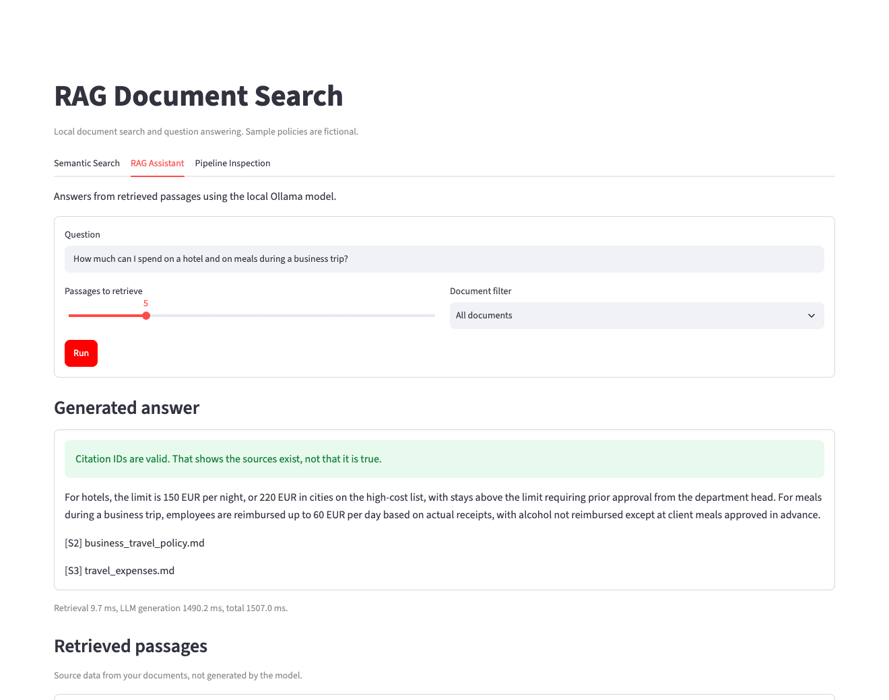
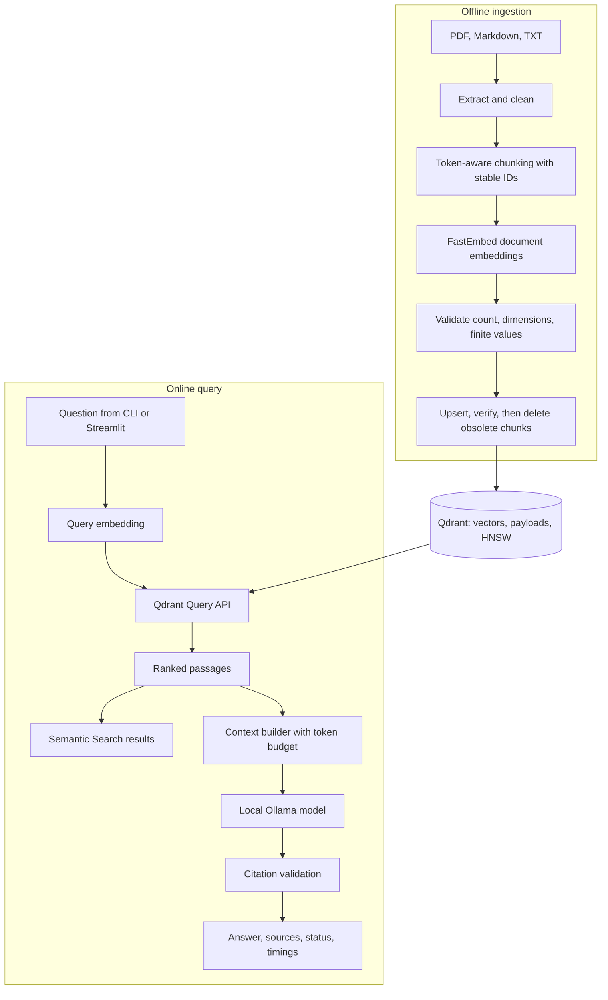
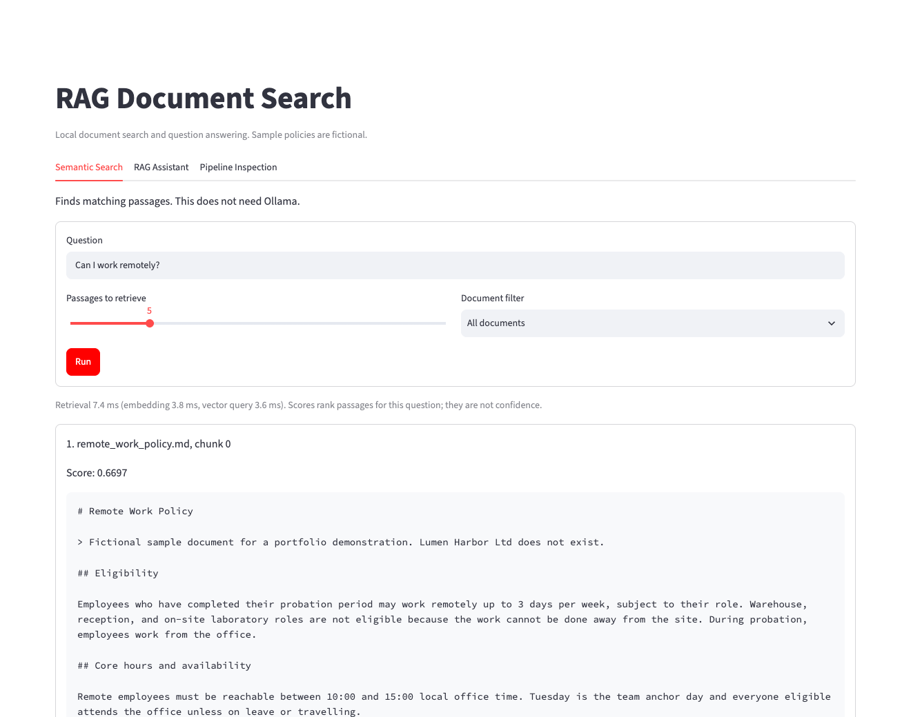
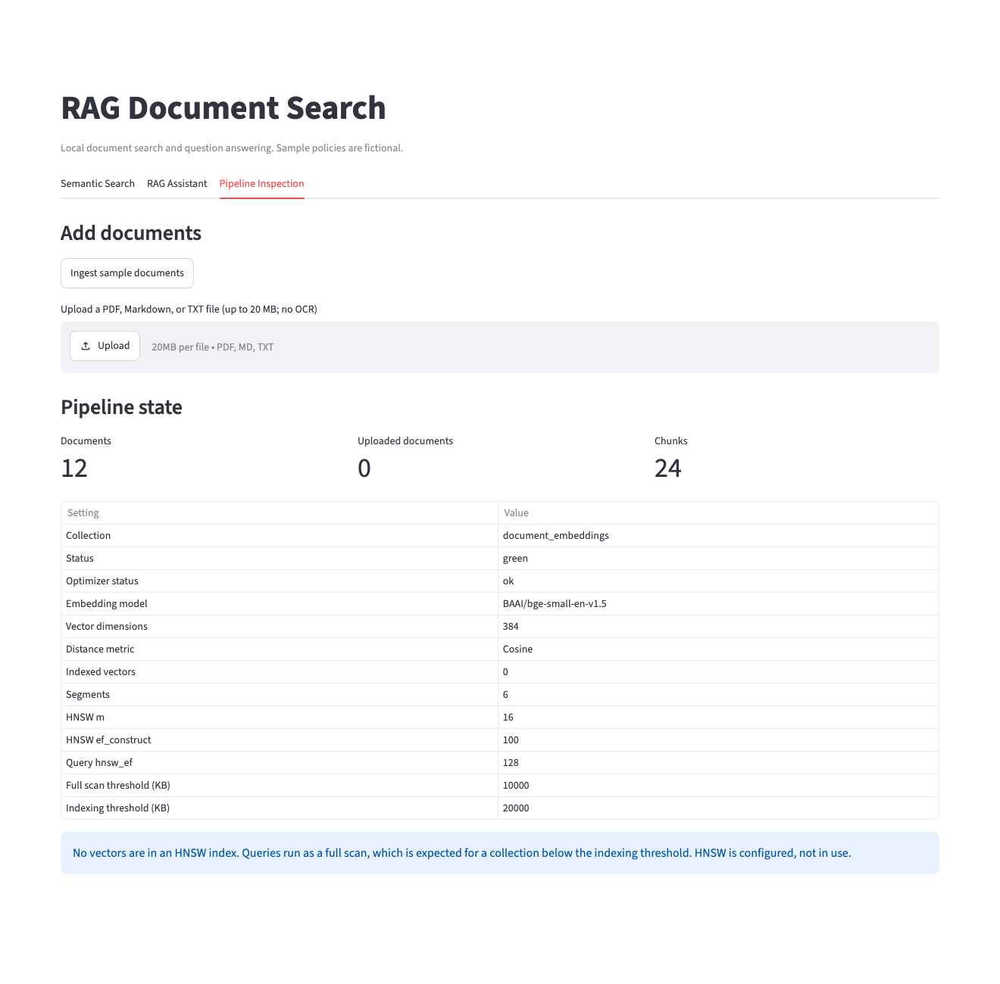

# End-to-End RAG Pipeline: Embeddings, HNSW Vector Search & Local LLM

A local-first document search and question-answering system, built as a data engineering portfolio
project. It takes documents from raw files to grounded answers with validated source IDs, and
shows each step directly, with no RAG framework hiding the work.

```text
Raw documents → Text extraction → Chunking → Embeddings → Qdrant vector indexing
              → Semantic search → Context construction → Local LLM → Grounded answers
```

It runs entirely on your machine, with no paid APIs. The sample documents are fictional.



## The problem

Keyword search misses meaning: “vacation” does not match “annual leave”. Chatbots invent answers.
RAG addresses both by finding relevant passages and answering from them. In practice, most of the
hard problems are data engineering: keeping an index in sync with changing files, never silently
losing text, and knowing what you can actually prove about a result. This project concentrates on
those problems.

## Technology

| Technology | Purpose |
|---|---|
| Python 3.12, uv | Language and locked dependencies |
| PyMuPDF | PDF extraction |
| FastEmbed, ONNX Runtime | Local embedding inference |
| `BAAI/bge-small-en-v1.5` | 384-dimensional embedding model |
| Qdrant 1.20.0, HNSW | Vector database and index |
| Ollama, `qwen3:4b-instruct-2507-q4_K_M` | Local LLM |
| Streamlit | User interface |
| Docker Compose | Runs Qdrant, on localhost only |
| Pydantic Settings, pytest, Ruff, GitHub Actions | Configuration and quality |

Why these and not others: see [engineering decisions](docs/engineering_decisions.md).

## Architecture



The two paths run independently, and semantic search works with Ollama switched off. More detail is
in [architecture](docs/architecture.md).

## How it works

**Ingestion.** Each file is read once, so its hash and text describe the same bytes. Corrupt,
encrypted, empty, or wrongly encoded files are reported without stopping the others. Scanned PDFs
need OCR, which is not supported. See [ingestion](docs/ingestion.md).

**Embeddings.** Text becomes 384 numbers such that similar meanings lie close together. FastEmbed
silently truncates long input, so the pipeline counts tokens first with an untruncated tokenizer and
rejects oversized text. Every vector is checked before storage, and the model is a pinned local
file verified by SHA-256. See [embeddings](docs/embeddings.md).

**Vector indexing.** Each chunk is a Qdrant point: a vector plus a payload with its text and source.
The collection is validated before use, and data from another model or chunking setup is refused,
because equal dimensions do not make vectors comparable.

**HNSW.** Hierarchical Navigable Small World is a layered graph. Search enters at sparse upper
layers, moves toward closer vectors, and refines in denser lower layers. It trades some recall for
speed at scale. The configuration exists here, but **the 24-chunk sample collection has no graph**:
it sits below the indexing threshold, so queries are full scans, and the inspection tools say so.
See [vector indexing](docs/vector_indexing.md).

**Semantic retrieval.** A question is embedded once, with the BGE instruction, and sent to the Query
API with an optional source filter. Scores rank passages for that question; they are not confidence.

**RAG.** The context builder fits whole passages into a budget counted with the LLM's own tokenizer
and template, escaping document text so it cannot break out of its data block. The model must return
structured JSON listing its sources, and code checks those IDs. If Ollama fails, you get a clear
status and the passages. See [RAG explained](docs/rag_explained.md).

## Setup

You need Python tooling through [uv 0.13.6](https://docs.astral.sh/uv/getting-started/installation/),
Docker with Compose, and optionally [Ollama](https://ollama.com) for the assistant. The full workflow
was tested on macOS on Apple Silicon. Lint, unit tests, and Qdrant tests also passed in Ubuntu 24.04
containers; the model workflow was not tested on Linux. Planning assumes 16 GiB of RAM for the full
demo; that figure is a budget, not a measured minimum.

```bash
uv python install 3.12.16
uv sync --locked
cp .env.example .env

docker compose up -d qdrant
curl -fsS --retry 15 --retry-all-errors --retry-delay 1 --max-time 30 http://127.0.0.1:6333/readyz

uv run --locked python scripts/prepare_assets.py --embedding-model
uv run --locked python scripts/ingest.py
```

For the assistant, in a separate terminal:

```bash
OLLAMA_NO_CLOUD=1 ollama serve
```

Then:

```bash
ollama pull qwen3:4b-instruct-2507-q4_K_M
uv run --locked python scripts/prepare_assets.py --generation-tokenizer
```

Python and Ollama both run on the host, so `http://127.0.0.1:11434` needs no Docker networking.
Downloads happen only in `prepare_assets.py` and `ollama pull`. Normal runs never fetch anything.

Qdrant has no authentication by default and publishes only `127.0.0.1:6333`. Data lives in a named
Docker volume. `docker compose stop qdrant` keeps it; `docker compose down --volumes` deletes it.

## Commands

```bash
uv run --locked python scripts/ingest.py                         # Sync documents into Qdrant
uv run --locked python scripts/ingest.py --dry-run               # Extract and chunk only; no services
uv run --locked python scripts/ingest.py --prune-missing --dry-run
uv run --locked python scripts/ingest.py --delete-source remote_work_policy.md
uv run --locked python scripts/inspect_embeddings.py "Employees receive 25 days of annual leave."
uv run --locked python scripts/inspect_embeddings.py --compare
uv run --locked python scripts/inspect_index.py
uv run --locked python scripts/search.py "Can I work remotely?" --top-k 5
uv run --locked python scripts/ask.py "How many days of annual leave do employees get?"
uv run --locked python scripts/evaluate.py --mode retrieval
uv run --locked python scripts/benchmark.py --points 10000 --queries 100 --seed 42 --top-k 10
uv run --locked streamlit run app/streamlit_app.py
```

Each script supports `--help`. Exit code 2 means the command could not run.

## Application

The Streamlit app binds to localhost. It is a trusted single-user tool without authentication.





These are screenshots of the running application with fictional data.

## Evaluation

Measured on 12 fictional documents and 25 labeled questions. One question moves a percentage by 5
points, so these results describe the method on this corpus and should not be generalized.

| Metric, 256/40 chunks, K=5 | Result |
|---|---|
| Hit Rate@5 / Recall@5 | 100% / 100% |
| MRR@5 | 0.912 |
| Citation validity | 26 of 26 references |
| Correct refusals, unanswerable questions | 5 of 5 |
| Wrongful refusals, answerable questions | 0 of 20 |
| Correctness | 18 fully supported, 7 partial, 0 wrong |
| Generation latency, mean / p95 | 1,992 ms / 2,537 ms |

**Correctness was scored by the implementing agent, delegated by the project owner, not by a
human reviewer.** See
[evaluation](docs/evaluation.md) for definitions, chunk-size comparison, and limits.

## Benchmark

```bash
uv run --locked python scripts/benchmark.py --points 50000 --queries 100 --seed 42 --top-k 10
```

| Points | Mode | Recall@10 | Mean latency |
|---|---|---|---|
| 10,000 | Exact | 1.000 | 2.18 ms |
| 10,000 | `hnsw_ef` 256 | 0.867 | 2.69 ms |
| 50,000 | Exact | 1.000 | 3.89 ms |
| 50,000 | `hnsw_ef` 32 | 0.085 | 2.15 ms |
| 50,000 | `hnsw_ef` 256 | 0.412 | 3.89 ms |

**HNSW gave no useful win here.** Random 384-dimensional vectors are a hard case for graph indexes,
so this does not estimate recall on real text. It runs in its own collection with held-out queries
and takes timings only after index readiness is verified.
[Vector indexing](docs/vector_indexing.md#benchmark-results) has the full table.

## Reliability and idempotency

- **Deterministic IDs.** Chunk IDs derive from content, so reruns overwrite instead of duplicating.
- **Safe updates.** New chunks are written and verified before old ones are deleted. A failure
  leaves old text in place, and rerunning finishes the job.
- **Not a transaction.** During an update, readers can see old and new chunks together. The
  guarantee is convergence, not atomicity.
- **No silent loss.** Oversized text is rejected, and limits reject a whole file rather than
  indexing part of it.
- **Deletion is explicit.** A missing file stays indexed until pruned, and pruning refuses an
  empty or unreadable listing.
- **One writer.** A file lock allows one writer per collection on one host.

## Limitations

- No OCR. English is the validated language.
- Multi-column PDFs and tables can extract poorly; chunks do not cross pages.
- An edited document is fully re-embedded.
- Valid citations show that a source exists, not that it supports a claim. The evaluation has a
  real example of this.
- Prompt injection is limited, not eliminated.
- Uploads cannot yet be removed.
- CPU embedding, one generation at a time, and one writer per host.
- Local single-user only: no authentication.

## Future improvements

- Hybrid keyword and vector search, the most likely fix for the “vacation” weakness.
- Reranking, incremental re-embedding of changed chunks, and OCR.
- Larger evaluation with independent question authors.
- A benchmark on real embeddings, which would say more about HNSW than random vectors do.
- A larger-scale version on Azure Databricks, PySpark, Delta Lake, Unity Catalog, and Databricks AI
  Search. This is a documented [mapping](docs/architecture.md#future-databricks-mapping) only.

## Testing

```bash
uv run --locked pytest                    # Fast unit tests; no services or models
uv run --locked pytest tests/integration  # Needs Qdrant, models, and Ollama
```

See [testing](docs/testing.md) for what runs where.

## Interview demonstration

[The walkthrough](docs/interview_walkthrough.md) is a five-to-seven-minute demo script with the
engineering tradeoffs to discuss.

## License

[GNU AGPL v3](LICENSE) (`AGPL-3.0-only`), consistent with the PyMuPDF dependency. Dependencies keep
their own licenses.
