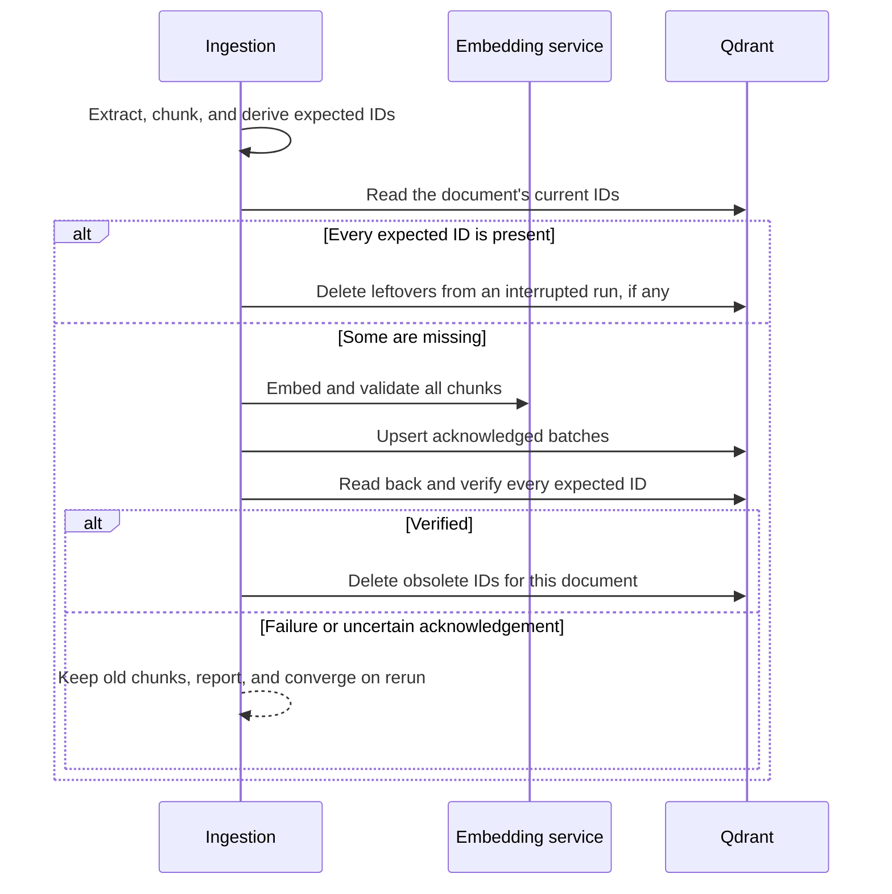
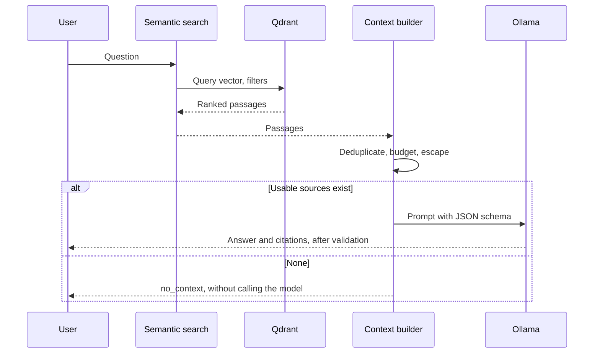

# Architecture

One Python package, one Qdrant service, and a native Ollama process. There are no microservices or
orchestration layers, because the project is about the data flow, and a single host needs neither.

## Components

| Component | Module | Responsibility |
|---|---|---|
| Configuration | `config.py` | Validated settings, with no side effects |
| Assets | `assets.py` | Explicit downloads and checksum verification |
| Loading | `ingestion/document_loader.py` | Safe file reading and text extraction |
| Cleaning, chunking | `ingestion/text_cleaner.py`, `chunker.py` | Token-bounded, offset-based chunks |
| Embeddings | `embeddings/embedding_service.py` | Text to validated vectors |
| Storage | `vector_store/qdrant_store.py` | Collection contract and operations |
| Synchronization | `ingestion/synchronization.py` | Upsert, verify, delete; writer lock |
| Retrieval | `retrieval/semantic_search.py` | Question to ranked passages |
| Context | `rag/context_builder.py` | Budgeted, escaped prompt |
| Generation | `rag/llm_service.py` | Ollama adapter |
| Citations | `rag/citation_validator.py` | Checks IDs against sources sent |
| RAG | `rag/rag_service.py` | Orchestration and statuses |
| Evaluation | `evaluation/` | Labels, metrics, benchmark |
| Interfaces | `scripts/`, `app/`, `app_services.py` | Thin adapters over the services |

Dependencies point one way: RAG uses retrieval, and retrieval knows nothing about RAG. A test
confirms that importing search loads neither the RAG package nor the `ollama` client.

## Document update sequence

Qdrant offers no transaction across these steps, so the design relies on deterministic IDs and
ordering. Nothing valid is deleted first, and every step is safe to repeat.

## Query path

## Trust boundaries

Documents, retrieved text, and model output are all untrusted. File paths are confined to a source
root, uploads get generated names, document text is escaped in prompts, the UI renders it literally,
and the model has no tools. Services publish only to localhost. See
[RAG explained](rag_explained.md#trust-boundaries).

## Future Databricks mapping

This is a design note. Nothing here is implemented.

| Here | At larger scale |
|---|---|
| Local files | Cloud storage with Unity Catalog volumes |
| Python ingestion | PySpark jobs |
| Chunk records | Delta Lake tables, with change data feed for updates |
| ID reconciliation | Delta `MERGE` on deterministic IDs |
| Qdrant collection | Databricks AI Search index, synced from Delta |
| Fingerprints | Table properties and Unity Catalog lineage |

The deterministic IDs and fingerprints carry over directly. Delta would replace the upsert-verify-
delete procedure with atomic table commits, though syncing a derived index remains eventually
consistent.
